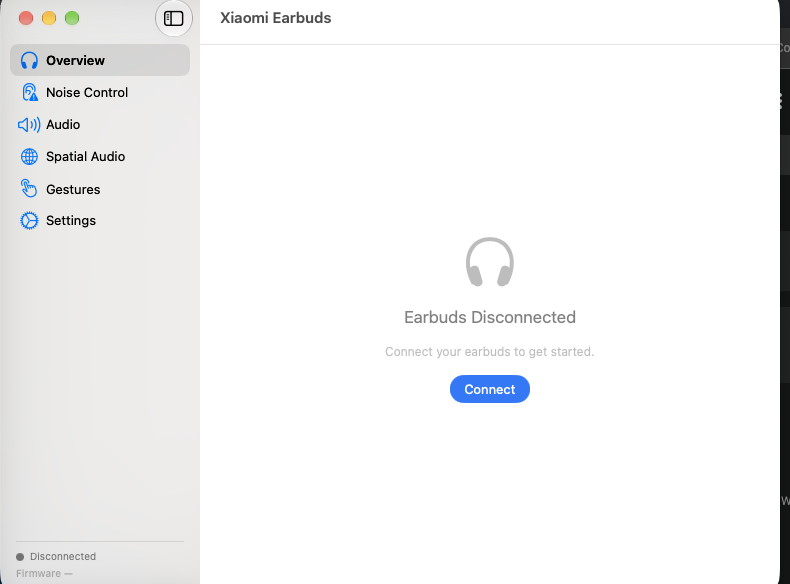
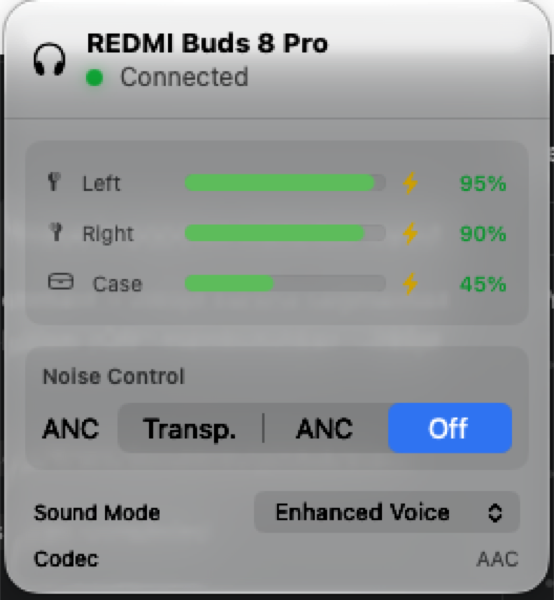

# 🎧 Xiaomi Earbuds — Native macOS Companion App

A native macOS companion app for **Xiaomi / Redmi TWS earbuds**. Built with SwiftUI, it talks to the earbuds directly over Bluetooth Classic RFCOMM using the reverse-engineered JieLi RCSP protocol — no account, no phone, no vendor app.

> **No Xiaomi account required. No phone needed. Pure macOS.**



## ✨ Features

| Feature | Status | Description |
|---------|--------|-------------|
| 🔋 Battery Levels | ✅ | Real-time Left / Right / Case battery with charging indicator |
| 🔇 ANC Control | ✅ | Switch between Transparency, Noise Cancellation, and Off |
| 🎚️ ANC Depth | ✅ | Adjust noise cancellation intensity (Light ↔ Deep) |
| 🎵 Sound Mode (EQ) | ✅ | Balanced, Enhanced Voice, Enhanced Bass, Enhanced Treble |
| 👆 Gestures | ✅ | Customize Single/Double/Triple press, Hold, and Swipe |
| 🔔 Find Device | ✅ | Play sound on earbuds to locate them |
| 📡 Dual Connection | ✅ | Toggle dual-device connectivity |
| 📞 Auto Answer | ✅ | Toggle automatic call answering |
| 🎮 Low Latency | ✅ | Toggle game mode for reduced audio delay |
| 🔊 Adaptive Sound | ✅ | Toggle environment-aware audio adjustment |
| 📊 Menu Bar App | ✅ | Quick access popover from macOS menu bar |
| 🔄 Auto-Connect | ✅ | Connects automatically on app launch |
| 💓 Heartbeat | ✅ | Detects disconnection within 15-45 seconds |
| 🌙 Dark / Light Mode | ✅ | Follows macOS system appearance |

## 📸 Screenshots

### Main Window


### Menu Bar Popover


## 🏗️ Architecture

```
SwiftUI Views ──► @Observable ViewModels ──► XiaomiProtocol (RCSP Actor)
                                                    │
                                              ClassicBTManager
                                              │ IOBluetooth RFCOMM Ch.28
                                              ▼
                                    Xiaomi / Redmi earbuds
```

- **Protocol**: JieLi RCSP over Bluetooth Classic RFCOMM (MIWEAR service)
- **Authentication**: Challenge-response crypto (recovered from `libxm_bluetooth.so`)
- **Frame format**: `[FE DC BA] [flags] [opcode] [length BE] [payload] [EF]`
- **UI**: SwiftUI with `NavigationSplitView`, `.segmented` picker, `.radioGroup`, `Form`

## 📋 Requirements

- **macOS 15 Sequoia** or later
- **Xcode 16+** (for building — needed for proper code signing)
- Your **Xiaomi / Redmi earbuds** paired via System Settings → Bluetooth
- Earbuds must **not** be connected to another device (phone) — disconnect from phone first

## 🚀 Getting Started

### Build from Source

```bash
# Clone
git clone https://github.com/user/xiaomi-earbuds.git
cd xiaomi-earbuds

# Generate Xcode project
brew install xcodegen
xcodegen generate

# Open in Xcode
open XiaomiEarbuds.xcodeproj

# Set your Team in Signing & Capabilities, then ⌘R to build & run
```

### Install from Release

1. Download `XiaomiEarbuds.app.zip` from [Releases](../../releases)
2. Unzip and move to `/Applications`
3. Right-click → Open (first launch — bypass Gatekeeper)
4. Pair your earbuds in System Settings → Bluetooth
5. The app auto-connects on launch

## 🔬 Protocol Documentation

See [`docs/PROTOCOL_RE_FINDINGS.md`](docs/PROTOCOL_RE_FINDINGS.md) for the full reverse-engineered protocol specification, including:

- RCSP frame format and opcodes
- Authentication handshake (with crypto tables)
- Config IDs for all features (ANC, EQ, gestures, find device, etc.)
- Verified command/response examples from real hardware

## 📁 Project Structure

```
XiaomiEarbuds/
├── App/                    # Entry point, AppDelegate
├── DesignSystem/           # Color/Typography/Spacing tokens, reusable components
├── Models/                 # Data models (ANCMode, BatteryInfo, GestureConfig, etc.)
├── ViewModels/             # @Observable VMs (Device, NoiseControl, Audio, Gestures, Settings)
├── Views/
│   ├── MenuBar/            # Menu bar popover
│   ├── MainWindow/         # NavigationSplitView + sidebar
│   ├── Pages/              # Overview, NoiseControl, Audio, SpatialAudio, Gestures, Settings
│   └── Sheets/             # Rename, FindDevice modals
├── Services/
│   ├── Bluetooth/          # ClassicBTManager (RFCOMM), BluetoothManager, BLEManager
│   └── Protocol/           # XiaomiProtocol, CommandBuilder, ResponseParser, ProtocolConstants
└── Utilities/              # Extensions, logging
```

## 🤝 Compatible Devices

Tested and working:
- ✅ **REDMI Buds 8 Pro** (VID 0x2717, PID 0x50E3/0x50E5)

Likely compatible (same JieLi RCSP protocol family):
- Redmi Buds 8 / 8 Lite / 8 Active
- Redmi Buds 7s / 6 Pro / 6 Lite / 6 Play / 6s
- Redmi Buds 5 Pro / 5, Redmi Buds 4 Pro / 4
- Xiaomi Buds 5 Pro / 5 / 4 Pro, Xiaomi OpenWear

> **Universal by design** — the device name shown in the app is read live from
> Bluetooth, and features are enabled only when the firmware reports support.
> To add a model, probe its config IDs (see `tools/rfcomm_connect.swift --probe`).

## 🙏 Credits

Protocol reverse-engineering informed by:
- [creeperkafasi/redmi-buds-linux](https://github.com/creeperkafasi/redmi-buds-linux) — Rust client with verified PROTOCOL.md
- [DanteFroMGiti/xiaomi-earbuds-control-linux](https://github.com/DanteFroMGiti/xiaomi-earbuds-control-linux) — GNOME app with device configs
- [Gadgetbridge](https://codeberg.org/Freeyourgadget/Gadgetbridge) — Android FOSS companion

## 📄 License

MIT License — see [LICENSE](LICENSE) for details.
