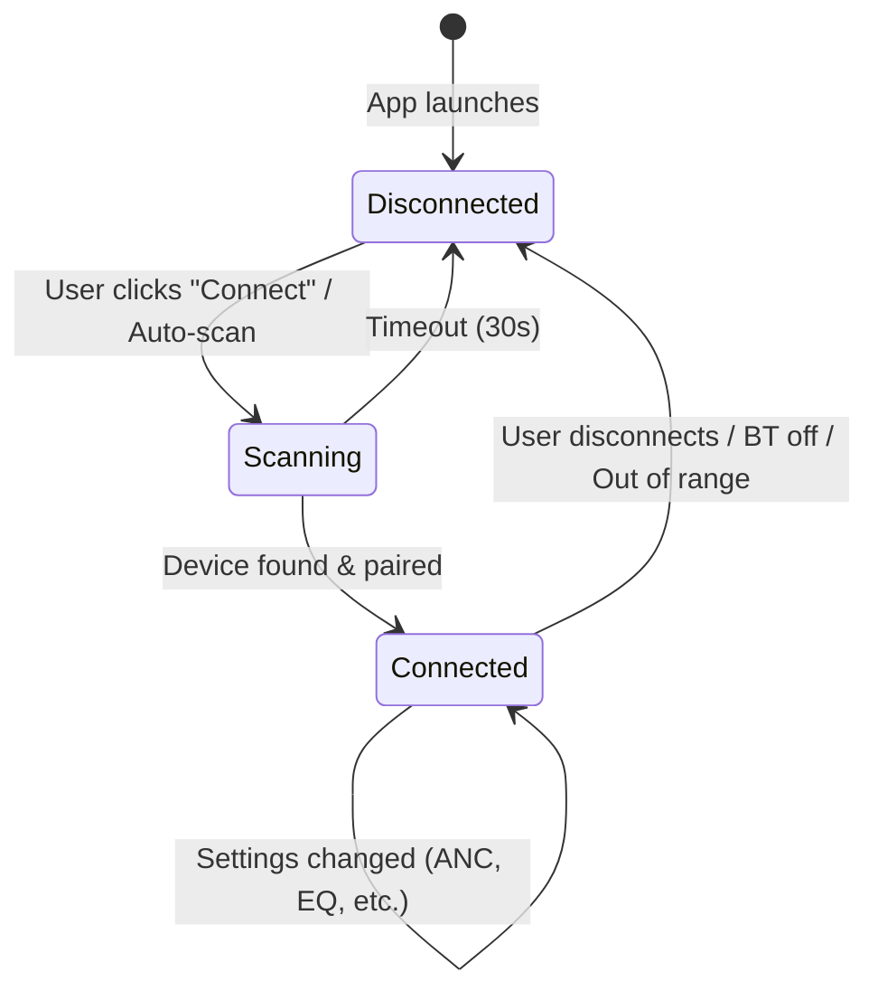
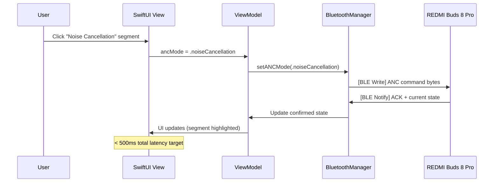

# 🎧 Xiaomi REDMI Buds 8 Pro — Native macOS Companion App

## Project Planning Document

**Date:** 2026-11-05  
**Device:** Xiaomi REDMI Buds 8 Pro (Firmware 3.2.2.6)  
**BT Address:** B8:53:84:6B:BD:88  
**Supported Protocols:** HFP, AVRCP, A2DP, ACL  
**Audio Codecs:** LDAC (48.0 kHz default), AAC, SBC  
**Platform:** macOS 15 Sequoia+ (Native SwiftUI App)  
**Design System:** Apple Human Interface Guidelines (HIG) 2026  

---

## 👥 Team Structure & Responsibilities (7 Agents)

### 1. 👔 Lead Product Manager — *Strategic Vision & Roadmap*
| Area | Responsibility |
|------|---------------|
| Vision | Define product vision: "Best-in-class macOS companion for Xiaomi earbuds" |
| Roadmap | Phase-based delivery (MVP → V1 → V2) |
| Market Analysis | Competitive analysis vs AirPods integration, Sony Headphones Connect, Bose Connect |
| Prioritization | Feature prioritization using MoSCoW framework |
| Stakeholders | Cross-team alignment, sprint planning, decision-making |
| Metrics | Define success metrics (DAU, feature adoption, NPS) |
| Go-to-Market | Distribution strategy (direct DMG vs Mac App Store) |

### 2. 📋 Product Manager — *Feature Specs & UX Research*
| Area | Responsibility |
|------|---------------|
| PRD | Write detailed Product Requirement Documents per feature |
| User Stories | Define user stories, acceptance criteria, edge cases |
| UX Research | User interviews, competitive UX teardowns (AirPods Settings, Sony app) |
| Wireframes | Lo-fi wireframes & user flows for every screen |
| Analytics | Define telemetry events and user flow tracking |
| UAT | Define UAT test scenarios and QA acceptance criteria |
| Feedback | Collect user feedback loop, feature requests, NPS surveys |

### 3. 🎨 Lead Frontend Engineer (macOS) — *UI Architecture & Design System*
| Area | Responsibility |
|------|---------------|
| Design System | Define reusable SwiftUI component library (tokens, spacing, colors) |
| HIG Compliance | Ensure all UI follows macOS 15 Sequoia HIG standards |
| UI Architecture | MVVM pattern, navigation architecture, state management |
| Accessibility | VoiceOver, Dynamic Type, keyboard navigation, reduced motion |
| Animations | Spring animations, transitions, micro-interactions |
| Theming | Dark/Light mode, accent color system, vibrancy effects |
| Code Review | Review all frontend PRs for design consistency |
| Prototyping | High-fidelity SwiftUI prototypes before implementation |

### 4. 🖥️ Frontend Engineer (macOS) — *UI Implementation*
| Area | Responsibility |
|------|---------------|
| Views | Implement all SwiftUI views (menu bar, main window, settings) |
| Components | Build reusable UI components (toggles, sliders, cards, pickers) |
| Menu Bar | NSStatusItem popover with quick controls |
| Animations | Implement animations, haptic feedback, transitions |
| Responsive | Window resizing, sidebar collapse, adaptive layouts |
| Assets | SF Symbols integration, custom icons, device illustrations |
| UI Testing | SwiftUI previews, snapshot tests, UI automation tests |
| Localization | i18n string extraction, RTL support, pluralization |

### 5. 🏗️ Lead Software Engineer — *Architecture & Tech Lead*
| Area | Responsibility |
|------|---------------|
| Architecture | System design, module decomposition, protocol design |
| Tech Stack | Swift 6, SwiftUI, CoreBluetooth, IOBluetooth decisions |
| Code Quality | Code review, CI/CD pipeline (Xcode Cloud / GitHub Actions) |
| Integration | BLE/Classic BT protocol integration, Xiaomi protocol RE |
| Performance | Memory/CPU profiling, battery impact, Instruments |
| Security | App Sandbox, Bluetooth entitlements, Hardened Runtime |
| Concurrency | Swift Concurrency (async/await, actors) architecture |

### 6. 💻 Software Engineer (macOS) — *Backend & Services Implementation*
| Area | Responsibility |
|------|---------------|
| BT Stack | CoreBluetooth/IOBluetooth implementation |
| Protocol | Xiaomi proprietary protocol encoder/decoder |
| Services | Implement service layer (BTManager, DeviceStore, etc.) |
| Testing | Unit tests, integration tests, mock BT testing |
| Packaging | DMG/PKG installer, notarization, Sparkle auto-update |
| CLI | Optional CLI tool for power users |
| Docs | Inline documentation, README, API docs |

### 7. 🔧 Hardware Engineer — *Bluetooth Protocol & Firmware*
| Area | Responsibility |
|------|---------------|
| Protocol RE | Reverse-engineer Xiaomi BLE GATT services & characteristics |
| Packet Analysis | Wireshark/PacketLogger BT HCI sniffing, protocol decoding |
| Codec Support | LDAC/AAC/SBC codec negotiation on macOS |
| Firmware | Firmware version detection, OTA update protocol analysis |
| Hardware Specs | Battery level reading, ear detection, IMU sensor data |
| Compatibility | Cross-device testing (Redmi Buds 5 Pro, other Xiaomi TWS) |
| Test Fixtures | Create BT protocol test fixtures & mock responses |

---

## 📊 Feature Matrix (from Android App Analysis)

Based on the Xiaomi Earbuds Android app screenshots, the following features need to be replicated:

### 🏠 Main Dashboard
| Feature | Priority | Complexity | Status |
|---------|----------|------------|--------|
| Device image & name display | P0 | Low | Planned |
| Battery level (Left / Right / Case) | P0 | Medium | Planned |
| Dolby Audio badge display | P1 | Low | Planned |
| Connection status indicator | P0 | Low | Planned |
| Quick connect/disconnect | P0 | Medium | Planned |

### 🔇 Noise Control
| Feature | Priority | Complexity | Status |
|---------|----------|------------|--------|
| ANC Mode toggle (Transparency / NC / Off) | P0 | High | Planned |
| Smart Noise Cancellation toggle | P0 | High | Planned |
| ANC Depth slider (Light ↔ Deep) | P1 | High | Planned |
| Immersive Commute mode | P2 | High | Planned |

### 🎵 Dimensional Audio
| Feature | Priority | Complexity | Status |
|---------|----------|------------|--------|
| Immersive Sound toggle | P1 | High | Planned |
| Audio Quality selector (Xiaomi Dimensional / Dolby) | P1 | High | Planned |
| Track Head Movement toggle | P2 | Very High | Planned |
| Scene Rendering presets (Standard/Music/Videos/Games/Audiobooks) | P1 | Medium | Planned |

### 🎚️ Audio Settings
| Feature | Priority | Complexity | Status |
|---------|----------|------------|--------|
| Absolute Volume toggle | P1 | Medium | Planned |
| Adaptive Sound toggle | P1 | High | Planned |
| Audio Quality / Codec selector (LDAC/AAC/SBC) | P0 | High | Planned |
| LDAC Sample Rate (44.1 / 48.0 / 96.0 kHz) | P1 | High | Planned |
| Sound Mode (Balanced/Enhanced Bass/Voice/Treble/Custom) | P0 | High | Planned |
| Custom EQ (10-band equalizer) | P1 | Very High | Planned |

### 👆 Gesture Customization
| Feature | Priority | Complexity | Status |
|---------|----------|------------|--------|
| Single press L/R configuration | P0 | High | Planned |
| Double press L/R configuration | P0 | High | Planned |
| Triple press L/R configuration | P1 | High | Planned |
| Press & hold L/R configuration | P0 | High | Planned |
| Swipe L/R configuration (volume) | P1 | High | Planned |

### ⚙️ Additional Settings
| Feature | Priority | Complexity | Status |
|---------|----------|------------|--------|
| In-ear detection toggle | P1 | High | Planned |
| Dual connection toggle | P1 | High | Planned |
| Auto-answer calls toggle | P2 | Medium | Planned |
| Rename device | P2 | Medium | Planned |
| Find device (play sound) | P1 | High | Planned |
| Ear tip fit test | P2 | Very High | Planned |
| Firmware update info | P1 | Medium | Planned |
| About device info | P1 | Low | Planned |

---

## 🏗️ Technical Architecture

### High-Level Architecture

```
┌─────────────────────────────────────────────────┐
│                  macOS App                       │
│  ┌──────────────────────────────────────────┐   │
│  │            SwiftUI Views                  │   │
│  │  ┌────────┐ ┌────────┐ ┌──────────────┐ │   │
│  │  │MenuBar │ │MainWin │ │  Settings    │ │   │
│  │  │Widget  │ │  dow   │ │   Views      │ │   │
│  │  └────┬───┘ └────┬───┘ └──────┬───────┘ │   │
│  └───────┼──────────┼────────────┼──────────┘   │
│          │          │            │               │
│  ┌───────┴──────────┴────────────┴──────────┐   │
│  │          ViewModel Layer                  │   │
│  │  ┌──────────┐ ┌──────────┐ ┌──────────┐ │   │
│  │  │DeviceVM  │ │ AudioVM  │ │SettingsVM│ │   │
│  │  └────┬─────┘ └────┬─────┘ └────┬─────┘ │   │
│  └───────┼────────────┼────────────┼────────┘   │
│          │            │            │             │
│  ┌───────┴────────────┴────────────┴────────┐   │
│  │          Service Layer                    │   │
│  │  ┌──────────────┐  ┌──────────────────┐  │   │
│  │  │ BTManager    │  │ XiaomiProtocol   │  │   │
│  │  │ (Discovery,  │  │ (Command encode/ │  │   │
│  │  │  Connection) │  │  decode, GATT)   │  │   │
│  │  └──────┬───────┘  └────────┬─────────┘  │   │
│  └─────────┼───────────────────┼────────────┘   │
│            │                   │                 │
│  ┌─────────┴───────────────────┴────────────┐   │
│  │     CoreBluetooth / IOBluetooth           │   │
│  │     (Apple Bluetooth Framework)           │   │
│  └──────────────────┬───────────────────────┘   │
└─────────────────────┼───────────────────────────┘
                      │
              ┌───────┴───────┐
              │ REDMI Buds 8  │
              │     Pro       │
              │ BT: Classic   │
              │   + BLE       │
              └───────────────┘
```

### Module Decomposition

```
XiaomiEarbuds/
├── App/
│   ├── XiaomiEarbudsApp.swift              # @main App entry, WindowGroup + MenuBarExtra
│   ├── AppDelegate.swift                   # NSStatusItem popover management
│   └── Assets.xcassets                     # App icon, accent color, device images
│
├── DesignSystem/                           # 🎨 Lead Frontend Engineer owns this
│   ├── Tokens/
│   │   ├── ColorTokens.swift               # Semantic colors (adapts to Dark/Light)
│   │   ├── TypographyTokens.swift          # Font scale (headline, body, caption, etc.)
│   │   └── SpacingTokens.swift             # Spacing constants (XS=4, SM=8, MD=12, LG=16)
│   ├── Components/
│   │   ├── BatteryGaugeView.swift          # Battery bar (green/yellow/red + %)
│   │   ├── ANCModePicker.swift             # Segmented 3-mode picker (Transparency/ANC/Off)
│   │   ├── DepthSlider.swift               # Light ↔ Deep slider with labels
│   │   ├── SettingToggleRow.swift           # Toggle with title + description subtitle
│   │   ├── GesturePickerRow.swift           # LabeledContent + Picker(.menu) for gestures
│   │   ├── CodecRadioGroup.swift            # Picker(.radioGroup) for LDAC/AAC/SBC
│   │   ├── SoundModeRadioGroup.swift        # Picker(.radioGroup) for EQ presets
│   │   ├── DeviceHeaderView.swift           # Hero image + name + Dolby badge
│   │   ├── SectionCard.swift                # GroupBox wrapper for grouped content
│   │   └── ConnectionStatusDot.swift        # Animated pulse dot (connected/disconnected)
│   └── Previews/
│       └── ComponentCatalog.swift           # SwiftUI Preview catalog for all components
│
├── Models/
│   ├── EarbudDevice.swift                  # @Observable device model
│   ├── BatteryInfo.swift                   # Battery levels (L/R/Case) with color logic
│   ├── ANCMode.swift                       # Enum: transparency, noiseCancellation, off
│   ├── AudioCodec.swift                    # Enum: ldac, aac, sbc
│   ├── SampleRate.swift                    # Enum: khz44_1, khz48_0, khz96_0
│   ├── SoundMode.swift                     # Enum: balanced, bass, voice, treble, custom
│   ├── AudioQuality.swift                  # Enum: xiaomiDimensional, dolbyAudio
│   ├── SceneRendering.swift                # Enum: standard, music, videos, games, audiobooks
│   ├── GestureAction.swift                 # Enum: none, playPause, nextSong, noiseControl, volume
│   ├── GestureConfig.swift                 # Gesture mappings for all 10 gesture slots
│   └── DeviceSettings.swift                # In-ear detection, dual connection, etc.
│
├── ViewModels/                             # @Observable ViewModels (Swift 6)
│   ├── DeviceViewModel.swift               # Connection state, battery, device info
│   ├── NoiseControlViewModel.swift         # ANC mode, smart ANC, depth, immersive commute
│   ├── AudioViewModel.swift                # Codec, sample rate, sound mode, EQ bands
│   ├── SpatialAudioViewModel.swift         # Immersive sound, head tracking, scene rendering
│   ├── GestureViewModel.swift              # Gesture configuration for all 10 slots
│   └── SettingsViewModel.swift             # In-ear, dual connection, rename, find device
│
├── Views/
│   ├── MenuBar/                            # 🖥️ Surface 1: Menu Bar Popover
│   │   ├── MenuBarPopoverView.swift        # Main popover content (320×480pt)
│   │   ├── QuickBatteryView.swift          # L/R/Case battery row
│   │   ├── QuickANCView.swift              # Segmented ANC picker + depth slider
│   │   └── QuickActionsView.swift          # Sound mode dropdown + "Open Settings" button
│   │
│   ├── MainWindow/                         # 🖥️ Surface 2: Settings Window
│   │   ├── MainWindowView.swift            # NavigationSplitView (sidebar + detail)
│   │   ├── SidebarView.swift               # Sidebar list with SF Symbol icons
│   │   └── ContentRouter.swift             # Routes sidebar selection → detail view
│   │
│   ├── Pages/                              # 🖥️ Surface 3: Detail Pane Pages
│   │   ├── OverviewPage.swift              # Dashboard: device hero, battery, quick ANC
│   │   ├── NoiseControlPage.swift          # ANC mode, smart ANC, depth, immersive commute
│   │   ├── AudioPage.swift                 # Codec, sample rate, sound mode, EQ
│   │   ├── SpatialAudioPage.swift          # Immersive sound, head tracking, scene rendering
│   │   ├── GesturesPage.swift              # 5 sections × 2 (L/R) gesture pickers
│   │   └── SettingsPage.swift              # Toggles, rename, find device, firmware, about
│   │
│   └── Sheets/                             # Modal sheets
│       ├── RenameSheet.swift               # TextField for device rename
│       ├── EarTipFitTestSheet.swift         # Ear tip fit test flow
│       ├── FindDeviceSheet.swift            # "Playing sound on earbuds..." progress
│       └── FirmwareUpdateSheet.swift        # Firmware update flow
│
├── Services/
│   ├── Bluetooth/
│   │   ├── BluetoothManager.swift          # actor: BT discovery & connection lifecycle
│   │   ├── BLEManager.swift                # BLE GATT read/write/notify operations
│   │   └── ClassicBTManager.swift          # Classic BT (RFCOMM/L2CAP) channel
│   ├── Protocol/
│   │   ├── XiaomiProtocol.swift            # Xiaomi proprietary protocol codec
│   │   ├── CommandBuilder.swift            # Build command payloads to send
│   │   ├── ResponseParser.swift            # Parse device notification payloads
│   │   └── ProtocolConstants.swift         # Known UUIDs, opcodes, service IDs
│   └── Persistence/
│       ├── AppSettings.swift               # @AppStorage wrapper for preferences
│       └── DeviceStore.swift               # SwiftData model for paired device history
│
├── Utilities/
│   ├── Extensions/
│   │   ├── Data+Hex.swift                  # Data ↔ hex string helpers
│   │   ├── Color+Battery.swift             # Battery level → color mapping
│   │   └── View+ConditionalModifier.swift  # Conditional view modifiers
│   └── Logging/
│       └── AppLogger.swift                 # os.Logger categories (bt, ui, protocol)
│
├── Tests/
│   ├── UnitTests/
│   │   ├── ProtocolTests.swift             # Command builder + response parser
│   │   ├── ViewModelTests.swift            # ViewModel state logic
│   │   └── ModelTests.swift                # Model encoding/decoding
│   ├── UITests/
│   │   └── NavigationTests.swift           # Sidebar navigation, popover behavior
│   └── SnapshotTests/
│       └── ComponentSnapshotTests.swift    # Visual regression for design system
│
└── Resources/
    ├── Localizable.xcstrings               # String Catalog (Xcode 15+)
    ├── DeviceImages/                       # Earbud illustrations (PDF vectors)
    └── Preview Content/                    # SwiftUI preview assets
```

### Tech Stack

| Component | Technology | Rationale |
|-----------|-----------|-----------|
| UI Framework | SwiftUI (macOS 15+) | Latest NavigationSplitView, `.radioGroup`, `.symbolEffect` |
| Language | Swift 6.0 | Strict concurrency, data-race safety |
| BLE Stack | CoreBluetooth | Apple's BLE framework with async/await wrappers |
| Classic BT | IOBluetooth | RFCOMM/L2CAP for proprietary data channel |
| Concurrency | Swift Concurrency | `@Observable`, `actor`, `async/await` |
| State | `@Observable` macro | SwiftUI Observation framework (not Combine) |
| Persistence | SwiftData / UserDefaults | Device profiles + app preferences |
| Logging | os.Logger | System-integrated logging with categories |
| Networking | Foundation (URLSession) | Firmware update checks |
| Build | Xcode 16+ / SPM | Swift 6 support, Xcode Cloud CI |
| Testing | Swift Testing + XCTest | Modern test framework + UI tests |
| Distribution | DMG + Notarization + Sparkle | Direct distribution with auto-update |
| Min macOS | macOS 15 Sequoia | Latest HIG patterns, SF Symbols 6 |
| Icons | SF Symbols 6 | `ear`, `headphones`, `waveform`, `speaker.wave.3` |

---

## 🗺️ Delivery Roadmap (7-Agent Team)

### Phase 0 — Research & Design Foundation (Week 1-2)
> **Parallel workstreams across all 7 agents**

| Agent | Task | Deliverable | Duration |
|-------|------|-------------|----------|
| 🔧 Hardware Engineer | BT PacketLogger/Wireshark sniffing setup | HCI capture environment | 1 day |
| 🔧 Hardware Engineer | BLE GATT service enumeration | Complete service/characteristic map | 2 days |
| 🔧 Hardware Engineer | Protocol decoding (commands/responses) | Protocol specification doc | 5 days |
| 🏗️ Lead SE | Android APK decompile + protocol analysis | Command ↔ Response mapping | 3 days |
| 🏗️ Lead SE | Xcode project setup, Swift Package structure | Buildable skeleton project | 1 day |
| 🎨 Lead FE | Design system foundation (tokens, colors, typography) | `DesignSystem/Tokens/` complete | 2 days |
| 🎨 Lead FE | Component library (BatteryGauge, ANCPicker, SettingToggle) | `DesignSystem/Components/` v1 | 3 days |
| 🎨 Lead FE | SwiftUI preview catalog | `ComponentCatalog.swift` | 1 day |
| 🖥️ Frontend Engineer | Menu bar app scaffold (NSStatusItem + NSPopover) | Clickable menu bar icon | 2 days |
| 📋 Product Manager | PRD for Phase 1 MVP features | PRD document with acceptance criteria | 3 days |
| 👔 Lead PM | Competitive analysis (AirPods Settings, Sony, Bose) | Competitive teardown report | 2 days |
| 👔 Lead PM | Approve roadmap + sprint planning | Sprint backlog | 1 day |

**Phase 0 Deliverables:**
- [ ] Complete BLE GATT service/characteristic map
- [ ] Protocol specification document with command ↔ response table
- [ ] Python/Swift proof-of-concept scripts for battery read + ANC switch
- [ ] Design system v1 with all tokens + 10 reusable components
- [ ] SwiftUI component preview catalog
- [ ] Xcode project scaffold (buildable, runs as menu bar app)
- [ ] Phase 1 PRD with user stories and acceptance criteria

---

### Phase 1 — MVP (Week 3-5)
> **Frontend & Backend work in parallel**

| Agent | Task | Deliverable | Duration |
|-------|------|-------------|----------|
| 💻 SE macOS | BluetoothManager actor (discovery, connection) | Auto-detect & connect to paired earbuds | 3 days |
| 💻 SE macOS | XiaomiProtocol encoder/decoder | Command builder + response parser | 3 days |
| 💻 SE macOS | Battery read service | Real-time L/R/Case battery polling | 2 days |
| 💻 SE macOS | ANC mode switch service | Write ANC commands to device | 2 days |
| 🔧 Hardware Engineer | Protocol test fixtures | Mock BT responses for testing | 2 days |
| 🎨 Lead FE | NavigationSplitView architecture | Sidebar + detail routing | 2 days |
| 🎨 Lead FE | Accessibility audit of all components | VoiceOver labels, keyboard nav | 1 day |
| 🖥️ Frontend Engineer | Menu bar popover UI (battery, ANC, quick actions) | Functional popover view | 3 days |
| 🖥️ Frontend Engineer | Overview page (device hero, battery bars) | Dashboard page | 2 days |
| 🖥️ Frontend Engineer | Noise control page (ANC picker, depth slider) | ANC controls page | 2 days |
| 🏗️ Lead SE | ViewModel layer (DeviceVM, NoiseControlVM) | MVVM binding layer | 2 days |
| 🏗️ Lead SE | Integration testing (VM ↔ BT service) | End-to-end ANC toggle test | 1 day |
| 📋 PM | UAT test plan for MVP features | Test scenarios document | 1 day |

**MVP Success Criteria:**
- [ ] App appears in menu bar with `headphones` SF Symbol
- [ ] Popover shows battery levels for L/R/Case with color-coded bars
- [ ] Can toggle ANC modes (Transparency / NC / Off) via segmented picker
- [ ] Can adjust ANC depth (Light ↔ Deep) via slider
- [ ] Main window opens with NavigationSplitView (sidebar + overview page)
- [ ] Auto-reconnects when earbuds come in range
- [ ] All controls have VoiceOver labels
- [ ] Works in both Dark and Light mode

---

### Phase 2 — Core Features (Week 6-9)
> **Full 7-agent team**

| Agent | Task | Deliverable | Duration |
|-------|------|-------------|----------|
| 💻 SE macOS | Codec switch service (LDAC/AAC/SBC) | Write codec selection to device | 2 days |
| 💻 SE macOS | Sound mode service (5 presets + custom) | Write EQ preset commands | 2 days |
| 💻 SE macOS | Gesture config read/write service | Read current + write new gestures | 3 days |
| 💻 SE macOS | Spatial audio service (immersive, head tracking) | Write spatial audio commands | 2 days |
| 🔧 Hardware Engineer | LDAC sample rate protocol decode | 44.1/48.0/96.0 kHz switching | 2 days |
| 🔧 Hardware Engineer | Gesture protocol decode (10 gesture slots) | Command format for all gestures | 2 days |
| 🎨 Lead FE | EQ visualizer component (10-band) | `EqualizerView` with draggable bands | 4 days |
| 🎨 Lead FE | Animation system (transitions, connection pulse) | Polished micro-interactions | 2 days |
| 🖥️ Frontend Engineer | Audio page (codec picker, sound mode radios) | Audio settings page | 3 days |
| 🖥️ Frontend Engineer | Spatial audio page (toggles, scene rendering radios) | Dimensional audio page | 2 days |
| 🖥️ Frontend Engineer | Gestures page (5 sections × L/R pickers) | Gesture configuration page | 3 days |
| 🖥️ Frontend Engineer | LDAC sample rate conditional section | Appears when LDAC selected | 1 day |
| 🏗️ Lead SE | AudioVM, SpatialAudioVM, GestureVM | ViewModel bindings for new pages | 3 days |
| 🏗️ Lead SE | Unit tests for all new ViewModels | ≥80% coverage | 2 days |
| 📋 PM | UAT for Phase 2 features | Acceptance testing | 2 days |
| 👔 Lead PM | Mid-project review, scope adjustment | Go/no-go for Phase 3 | 1 day |

---

### Phase 3 — Advanced Features (Week 10-12)
> **Full 7-agent team**

| Agent | Task | Deliverable | Duration |
|-------|------|-------------|----------|
| 💻 SE macOS | Find device service (play sound) | Trigger earbuds to beep | 2 days |
| 💻 SE macOS | In-ear detection toggle service | Read/write in-ear detect setting | 1 day |
| 💻 SE macOS | Dual connection toggle service | Read/write dual connection setting | 1 day |
| 💻 SE macOS | Device rename service | Write new name to device | 1 day |
| 💻 SE macOS | Firmware version read service | Read firmware + check for updates | 2 days |
| 🔧 Hardware Engineer | Ear tip fit test protocol decode | Measure seal quality data | 3 days |
| 🔧 Hardware Engineer | Adaptive sound protocol decode | Environmental audio analysis | 2 days |
| 🎨 Lead FE | Find device sheet with progress animation | Animated speaker wave UI | 1 day |
| 🎨 Lead FE | Ear tip fit test sheet (step-by-step flow) | Multi-step wizard UI | 2 days |
| 🖥️ Frontend Engineer | Settings page (all toggles + action buttons) | Complete settings page | 3 days |
| 🖥️ Frontend Engineer | Rename sheet, firmware update sheet | Modal sheet UIs | 2 days |
| 🖥️ Frontend Engineer | Connection/disconnection error states | Empty states, retry UI | 1 day |
| 🏗️ Lead SE | SettingsVM completion | ViewModel for all settings | 2 days |
| 🏗️ Lead SE | Error handling & retry logic | Graceful BT error recovery | 2 days |
| 📋 PM | Full feature UAT | Complete acceptance testing | 2 days |

---

### Phase 4 — Polish & Distribution (Week 13-15)
> **Lead FE + Lead SE + PMs**

| Agent | Task | Deliverable | Duration |
|-------|------|-------------|----------|
| 🎨 Lead FE | Final accessibility audit (VoiceOver, keyboard, contrast) | WCAG 2.1 AA compliance | 2 days |
| 🎨 Lead FE | Animation polish (spring curves, reduced motion fallbacks) | Polished interaction feel | 2 days |
| 🎨 Lead FE | Dark/Light mode audit (every screen) | No hardcoded colors | 1 day |
| 🖥️ Frontend Engineer | Localization (English + 简体中文 + Bahasa Indonesia) | `.xcstrings` string catalog | 3 days |
| 🖥️ Frontend Engineer | Snapshot tests for all components + pages | Visual regression suite | 2 days |
| 🖥️ Frontend Engineer | App icon design (1024×1024 + all sizes) | `AppIcon` asset catalog | 1 day |
| 💻 SE macOS | DMG packaging with custom background | Installer DMG | 1 day |
| 💻 SE macOS | Sparkle auto-update integration | `appcast.xml` + code signing | 2 days |
| 🏗️ Lead SE | Apple notarization + Hardened Runtime | Notarized app bundle | 1 day |
| 🏗️ Lead SE | CI/CD pipeline (GitHub Actions → build → notarize → release) | Automated release | 2 days |
| 🏗️ Lead SE | Full test suite run (unit + UI + integration + snapshot) | ≥85% coverage, 0 failures | 2 days |
| 📋 PM | User guide + README + changelog | Documentation package | 2 days |
| 📋 PM | Beta testing coordination (TestFlight-like via Sparkle) | Beta feedback report | 3 days |
| 👔 Lead PM | Go-to-market: GitHub release + ProductHunt + Reddit | Launch plan | 2 days |
| 👔 Lead PM | Post-launch metrics monitoring (crash rate, DAU) | Metrics dashboard | Ongoing |
| 🔧 Hardware Engineer | Cross-device testing (Redmi Buds 5 Pro compatibility) | Compatibility report | 3 days |

---

## 🔬 Protocol Research Notes

### Known Bluetooth Profile Info

```
Device:     REDMI Buds 8 Pro
Address:    B8:53:84:6B:BD:88
Profiles:   HFP (Hands-Free), AVRCP (Media Control), A2DP (Audio), ACL
Battery:    Reported via standard BT battery service (100%)
Firmware:   3.2.2.6
Codecs:     LDAC (default), AAC, SBC
```

### Research Approach
1. **BLE GATT Enumeration** — Use CoreBluetooth to discover all services
2. **Android APK Analysis** — Decompile Xiaomi Earbuds APK to find protocol details
3. **BT HCI Sniffing** — Use macOS PacketLogger to capture commands from Android→Earbuds
4. **Open Source References** — Check existing projects:
   - `librebuds` (community reverse-engineering)
   - Xiaomi protocol documentation leaks
   - Similar projects for Redmi Buds 4/5 Pro

### Expected BLE Services (to discover)
| Service | Purpose |
|---------|---------|
| Battery Service (0x180F) | Battery level reporting |
| Device Information (0x180A) | Firmware, model, serial |
| Xiaomi Custom Service | ANC, EQ, gestures, settings |
| Audio Control | Codec selection, volume |

---

## 🎨 UI/UX Design Specification (macOS 15 Sequoia HIG)

> **Owner:** Lead Frontend Engineer + Frontend Engineer  
> **Design Reference:** Android Xiaomi Earbuds app screenshots → translated to macOS native patterns  
> **Target:** macOS 15 Sequoia+ with full Dark/Light mode, SF Symbols, vibrancy, accessibility

---

### Design Principles (Apple HIG Compliance)

| # | Principle | macOS HIG Mapping | Implementation |
|---|-----------|-------------------|----------------|
| 1 | **Platform Native** | Use macOS-native controls only — no Android/iOS lookalikes | `Toggle`, `Slider`, `Picker`, `Form`, `GroupBox` |
| 2 | **Menu Bar First** | macOS convention: accessories live in menu bar | `NSStatusItem` + `NSPopover` with SwiftUI content |
| 3 | **Settings Style Window** | macOS System Settings appearance (Ventura+) | `NavigationSplitView` with sidebar + detail |
| 4 | **Vibrancy & Materials** | Glass-like sidebar, `.ultraThinMaterial` backgrounds | `.background(.ultraThinMaterial)`, `.windowStyle(.titleBar)` |
| 5 | **Dark + Light Mode** | Full appearance support, no hardcoded colors | `Color(.controlBackgroundColor)`, semantic colors only |
| 6 | **Accessibility First** | VoiceOver labels on all controls, keyboard nav | `.accessibilityLabel()`, `.focusable()`, Tab order |
| 7 | **Reduced Motion** | Respect `accessibilityReduceMotion` preference | `@Environment(\.accessibilityReduceMotion)` |
| 8 | **Compact & Information-Dense** | macOS users expect more density than mobile | Smaller padding than iOS, use `controlSize(.small)` where appropriate |

---

### App Architecture — 3 Surface Types

#### Surface 1: Menu Bar Popover (Primary Quick Access)
> **Android Reference:** Main Dashboard screenshot — battery, ANC mode, device name  
> **macOS Pattern:** `NSStatusItem` → click → `NSPopover` with SwiftUI view  

```
┌─────────────────────────────────────────┐
│  🎧 ▾  (Menu Bar Icon — SF Symbol)      │
└────────────────────┬────────────────────┘
                     │ click
    ┌────────────────▼────────────────────┐
    │  ┌────────────────────────────────┐ │
    │  │  REDMI Buds 8 Pro     ● Connected│
    │  └────────────────────────────────┘ │
    │                                     │
    │  ┌─────────┬──────────┬──────────┐ │
    │  │  ◀ L    │   ▶ R    │  ▣ Case  │ │
    │  │  100%   │   100%   │    1%    │ │
    │  │  ████▌  │   ████▌  │  █░░░░  │ │
    │  └─────────┴──────────┴──────────┘ │
    │                                     │
    │  Noise Control                      │
    │  ┌──────┐ ┌──────────┐ ┌────────┐ │
    │  │ 🔊   │ │ 🔇 ANC   │ │ ⭕ Off │ │
    │  │Trans. │ │ ●Active  │ │        │ │
    │  └──────┘ └──────────┘ └────────┘ │
    │                                     │
    │  ANC Depth   Light ●━━━━━━━○ Deep  │
    │                                     │
    │  ─────────────────────────────────  │
    │  Sound Mode         [Balanced ▾]   │
    │  Audio Codec              LDAC ▸   │
    │  ─────────────────────────────────  │
    │         [ Open Settings… ]          │
    └─────────────────────────────────────┘
```

**macOS HIG components used:**
- `NSPopover` with `.contentSize(NSSize(width: 320, height: 420))`
- `Picker` with `.segmentedControl` style for ANC modes
- `Slider` for ANC depth
- `Menu` / `Picker` for Sound Mode dropdown
- Battery bars using `ProgressView` with `.linear` style
- `.background(.ultraThinMaterial)` for popover background
- SF Symbols: `ear`, `headphones`, `battery.100`, `waveform`

---

#### Surface 2: Main Settings Window (Full Control)
> **Android Reference:** All screenshots — translated to macOS System Settings layout  
> **macOS Pattern:** `NavigationSplitView` (sidebar + detail) — same as System Settings  

```
┌──────────────────────────────────────────────────────────────────────┐
│  ● ● ●              REDMI Buds 8 Pro                               │
├────────────────┬─────────────────────────────────────────────────────┤
│                │                                                     │
│   SIDEBAR      │              DETAIL PANE                           │
│  ┌───────────┐ │                                                     │
│  │🎧Overview │◀│  ┌─────────────────────────────────────────────┐   │
│  ├───────────┤ │  │         [Device Image]                       │   │
│  │🔇Noise    │ │  │      REDMI Buds 8 Pro                       │   │
│  │  Control  │ │  │        Dolby Audio                           │   │
│  ├───────────┤ │  │                                              │   │
│  │🎵Audio    │ │  │  ┌──────────┬──────────┬──────────┐         │   │
│  ├───────────┤ │  │  │  Left    │  Right   │  Case    │         │   │
│  │🌐Spatial  │ │  │  │  100%   │  100%    │   1%     │         │   │
│  │  Audio    │ │  │  └──────────┴──────────┴──────────┘         │   │
│  ├───────────┤ │  │                                              │   │
│  │👆Gestures │ │  │  ── Noise Control ──────────────────         │   │
│  ├───────────┤ │  │  Mode: [Transparency] [●ANC] [Off]          │   │
│  │⚙️Settings │ │  │  Smart ANC:        [████████████ ON]        │   │
│  │           │ │  │  Depth: Light ●━━━━━━━━━━━━━○ Deep          │   │
│  └───────────┘ │  │                                              │   │
│                │  │  ── Quick Actions ──────────────────         │   │
│  DEVICE STATUS │  │  Sound Mode:      [Balanced ▾]              │   │
│  ● Connected   │  │  Audio Codec:     [LDAC ▾]                  │   │
│  FW: 3.2.2.6  │  │                                              │   │
│                │  └─────────────────────────────────────────────┘   │
├────────────────┴─────────────────────────────────────────────────────┤
│                                                                      │
└──────────────────────────────────────────────────────────────────────┘
```

**macOS HIG layout rules:**
- **Sidebar width:** 200pt (collapsible, `.navigationSplitViewColumnWidth(200)`)
- **Sidebar style:** `.sidebar` list style with SF Symbol icons
- **Detail pane:** Scrollable `Form` or `List` with `Section` groupings
- **Grouped sections** using `GroupBox` or `Section` with headers
- **Window minimum size:** 680 × 500pt
- **Toolbar:** optional toolbar with device name centered

---

#### Surface 3: Settings Sub-pages (Drill-down Detail)
> **macOS Pattern:** Push navigation within detail pane (not new windows)

---

### Screen-by-Screen macOS Translation

#### 📱 Screenshot 1 → 🖥️ Overview (Dashboard)
**Android:** Device image, Dolby badge, battery (L/R/Case), ANC mode picker, Smart ANC toggle + slider, Immersive commute, navigation to Dimensional Audio / Audio / Gestures / Additional Settings

**macOS Translation:**

| Android Element | macOS Component | SwiftUI Implementation |
|-----------------|----------------|----------------------|
| Device hero image | Centered image in header | `Image("redmi-buds-8-pro").resizable().frame(height: 180)` |
| "Dolby Audio" badge | Subtle text label below image | `Text("Dolby Audio").font(.caption).foregroundStyle(.secondary)` |
| Battery L/R/Case | Three-column `HStack` with `ProgressView` | `ProgressView(value: 1.0).tint(batteryColor)` + `Label` |
| ANC 3-mode toggle | `Picker` with `.segmented` style | `Picker("Mode", selection: $ancMode) { }.pickerStyle(.segmented)` |
| Smart ANC toggle | macOS `Toggle` | `Toggle("Smart Noise Cancellation", isOn: $smartANC)` |
| ANC depth slider | macOS `Slider` with labels | `Slider(value: $depth, in: 0...1) { } minimumValueLabel: { Text("Light") } maximumValueLabel: { Text("Deep") }` |
| Immersive commute | `Toggle` or `Picker` dropdown | `Picker("Immersive Commute", selection: $commuteMode)` |
| Section navigation rows | These become **sidebar items** in macOS, not drill-down rows | `NavigationSplitView` sidebar `List` |

#### 📱 Screenshot 2 → 🖥️ Noise Control (cont'd)
**Android:** Scrolled down — Dimensional audio row, Audio row, Gestures row, Additional settings row, LDAC info banner, Phone calls / Media audio / Input device toggles, Disconnect / Unpair buttons

**macOS Translation:**

| Android Element | macOS Component | SwiftUI Implementation |
|-----------------|----------------|----------------------|
| Navigation rows (Dimensional audio, etc.) | Sidebar items (already mapped) | — |
| LDAC info banner | `Text` with `.callout` style in a `GroupBox` | `GroupBox { Text("LDAC provides high-quality...").font(.callout) }` |
| Phone calls / Media audio toggles | macOS `Toggle` in a `Section` | `Section("Audio Profiles") { Toggle(...) }` |
| Disconnect button | Destructive `.button` style | `Button("Disconnect") { }.tint(.red)` |
| Unpair button | Destructive button with confirmation | `Button("Unpair") { }.confirmationDialog(...)` |

#### 📱 Screenshot 3 → 🖥️ Dimensional Audio Page
**Android:** Immersive sound toggle, Audio quality picker (Xiaomi Dimensional / Dolby), Track head movement toggle, Scene rendering radio group (Standard / Music / Videos / Games / Audiobooks)

**macOS Translation:**

| Android Element | macOS Component | SwiftUI Implementation |
|-----------------|----------------|----------------------|
| Immersive sound toggle | macOS `Toggle` | `Toggle("Immersive Sound", isOn: $immersiveSound)` |
| Audio quality dropdown | `Picker` with `.menu` style | `Picker("Audio Quality", selection: $audioQuality) { Text("Xiaomi Dimensional Audio"); Text("Dolby Audio") }` |
| Track head movement toggle | macOS `Toggle` with description | `Toggle(isOn: $headTracking) { VStack(alignment: .leading) { Text("Track Head Movement"); Text("Enhanced sense of space...").font(.caption).foregroundStyle(.secondary) } }` |
| Scene rendering radio list | `Picker` with `.radioGroup` style | `Picker("Scene Rendering", selection: $scene) { }.pickerStyle(.radioGroup)` — **this is macOS-exclusive, not available on iOS** |

#### 📱 Screenshot 4 → 🖥️ Audio Quality Dropdown
**Android:** Popup showing "Xiaomi dimensional audio ✓" and "Dolby Audio" options

**macOS Translation:**
- Use `Picker` with `.menu` style — drops down a native macOS menu
- No need for a custom popup — this is a standard macOS pattern

```swift
Picker("Audio Quality", selection: $audioQuality) {
    Text("Xiaomi Dimensional Audio").tag(AudioQuality.xiaomi)
    Text("Dolby Audio").tag(AudioQuality.dolby)
}
.pickerStyle(.menu)
```

#### 📱 Screenshot 5 → 🖥️ Audio Settings Page
**Android:** Absolute volume toggle, Adaptive sound toggle, Audio quality (LDAC ▸), Sound mode (Balanced ▾)

**macOS Translation:**

| Android Element | macOS Component | SwiftUI Implementation |
|-----------------|----------------|----------------------|
| Absolute volume toggle | `Toggle` with description text | `Toggle(isOn:) { VStack { Text("Absolute Volume"); Text("Keep volume consistent...").font(.caption) } }` |
| Adaptive sound toggle | `Toggle` with description | Same pattern |
| Audio quality drill-down | `Picker` `.menu` or `NavigationLink` | `Picker("Audio Codec", selection: $codec) { Text("LDAC"); Text("AAC"); Text("SBC") }` |
| Sound mode drill-down | `Picker` `.menu` with options | `Picker` with 5 options + Custom |

#### 📱 Screenshot 6 → 🖥️ Sound Mode Popup
**Android:** Popup with Balanced ✓, Enhanced bass, Enhanced voice, Enhanced treble, Custom

**macOS Translation:**
- `Picker` with `.radioGroup` style (macOS native radio buttons)

```swift
Picker("Sound Mode", selection: $soundMode) {
    Text("Balanced").tag(SoundMode.balanced)
    Text("Enhanced Bass").tag(SoundMode.enhancedBass)
    Text("Enhanced Voice").tag(SoundMode.enhancedVoice)
    Text("Enhanced Treble").tag(SoundMode.enhancedTreble)
    Text("Custom").tag(SoundMode.custom)
}
.pickerStyle(.radioGroup)
```

#### 📱 Screenshot 7 → 🖥️ Codec Selector Page
**Android:** List: LDAC ✓ (High sound quality | 48.0 kHz), AAC (High quality), SBC (Basic sound quality)

**macOS Translation:**
- `Picker` with `.radioGroup` style, each option showing title + description

```swift
Section("Audio Codec") {
    Picker("Codec", selection: $codec) {
        VStack(alignment: .leading) {
            Text("LDAC")
            Text("High sound quality (CD level) | 48.0 kHz")
                .font(.caption).foregroundStyle(.secondary)
        }.tag(Codec.ldac)
        // ... AAC, SBC
    }
    .pickerStyle(.radioGroup)
}
```

#### 📱 Screenshot 8 → 🖥️ LDAC Sample Rate
**Android:** List: 44.1 kHz, 48.0 kHz ✓, 96.0 kHz with descriptions

**macOS Translation:**
- Conditional section that appears when LDAC is selected
- `Picker` with `.radioGroup`

```swift
if codec == .ldac {
    Section("LDAC Sample Rate") {
        Picker("Sample Rate", selection: $sampleRate) {
            Text("44.1 kHz — CD Quality").tag(SampleRate.khz44_1)
            Text("48.0 kHz — CD Quality").tag(SampleRate.khz48_0)
            Text("96.0 kHz — High Resolution").tag(SampleRate.khz96_0)
        }
        .pickerStyle(.radioGroup)
    }
}
```

#### 📱 Screenshot 9 → 🖥️ Gestures Configuration
**Android:** 10 gesture rows, each with L/R earphone and action picker (None, Play/Pause, Next song, Noise control, Adjust volume)

**macOS Translation:**
- `Form` with `Section` headers for gesture types
- Each gesture uses a `Picker` with `.menu` style (dropdown)
- Two-column layout: Left earphone | Right earphone

```
┌─────────────────────────────────────────────────────┐
│  Gestures                                            │
│                                                      │
│  ── Single Press ─────────────────────────────────  │
│  Left earphone:     [None ▾]                        │
│  Right earphone:    [None ▾]                        │
│                                                      │
│  ── Double Press ─────────────────────────────────  │
│  Left earphone:     [Play/Pause ▾]                  │
│  Right earphone:    [Play/Pause ▾]                  │
│                                                      │
│  ── Triple Press ─────────────────────────────────  │
│  Left earphone:     [Next Song ▾]                   │
│  Right earphone:    [Next Song ▾]                   │
│                                                      │
│  ── Press & Hold ─────────────────────────────────  │
│  Left earphone:     [Noise Control ▸]               │
│  Right earphone:    [Noise Control ▸]               │
│                                                      │
│  ── Swipe ────────────────────────────────────────  │
│  Left earphone:     [Adjust Volume ▾]               │
│  Right earphone:    [Adjust Volume ▾]               │
└─────────────────────────────────────────────────────┘
```

**SwiftUI:** `Form` → `Section("Single Press")` → `LabeledContent` + `Picker(.menu)`

#### 📱 Screenshot 10 → 🖥️ Additional Settings
**Android:** In-ear detection, Dual connection, Show notification shade, Answer calls automatically, Auto update earphones — all toggles. Then action rows: Rename, Find device, Ear tip fit test, Firmware update. Help section: About, FAQ, Feedback.

**macOS Translation:**

| Android Element | macOS Component | SwiftUI Implementation |
|-----------------|----------------|----------------------|
| Toggle rows (In-ear detection, etc.) | `Toggle` in `Form` > `Section` | Standard `Toggle` with description `VStack` |
| Rename | `TextField` or button → sheet with `TextField` | `Button("Rename…") { showRenameSheet = true }` |
| Find device | `Button` with speaker icon | `Button { } label: { Label("Find Device", systemImage: "speaker.wave.3") }` |
| Ear tip fit test | `Button` → opens test flow sheet | `Button("Start Ear Tip Fit Test…")` → `.sheet` |
| Firmware update | `LabeledContent` showing version | `LabeledContent("Firmware", value: "3.2.2.6")` + optional update button |
| About / FAQ / Feedback | Standard macOS "Help" menu items or Section | `Section("Help") { Link("FAQ", destination: url) }` |

---

### Design Tokens & Component Library

> **Owner:** Lead Frontend Engineer

#### Color System
```swift
extension Color {
    // Semantic colors — adapt to Light/Dark mode automatically
    static let cardBackground = Color(.controlBackgroundColor)
    static let sidebarBackground = Color(.sidebarBackgroundColor) // macOS sidebar
    static let primaryAccent = Color.accentColor // User's system accent color
    static let batteryGreen = Color.green
    static let batteryYellow = Color.yellow
    static let batteryRed = Color.red
    static let destructive = Color.red
    static let secondaryLabel = Color(.secondaryLabelColor)
    static let tertiaryLabel = Color(.tertiaryLabelColor)
}
```

#### Typography Scale (macOS SF Pro)
| Token | SwiftUI Font | Usage |
|-------|-------------|-------|
| `headline` | `.headline` (13pt semibold) | Section headers |
| `body` | `.body` (13pt regular) | Primary text, toggle labels |
| `callout` | `.callout` (12pt regular) | Descriptions under toggles |
| `caption` | `.caption` (10pt regular) | Battery percentages, subtle info |
| `title2` | `.title2` (17pt regular) | Device name in header |
| `largeTitle` | `.largeTitle` (26pt regular) | Window title (rarely used) |

#### Spacing System
| Token | Value | Usage |
|-------|-------|-------|
| `spacingXS` | 4pt | Between icon and label |
| `spacingSM` | 8pt | Between related elements |
| `spacingMD` | 12pt | Section internal padding |
| `spacingLG` | 16pt | Between sections |
| `spacingXL` | 20pt | Top/bottom page margins |
| `sidebarWidth` | 200pt | NavigationSplitView sidebar |
| `popoverWidth` | 320pt | Menu bar popover width |
| `popoverMaxHeight` | 480pt | Menu bar popover height |

#### Reusable Components
| Component | Purpose | macOS HIG Pattern |
|-----------|---------|-------------------|
| `BatteryGaugeView` | Battery level bar for L/R/Case | `ProgressView` + color coding (green >20%, yellow >10%, red ≤10%) |
| `ANCModePicker` | Segmented 3-mode ANC selector | `Picker(.segmented)` with SF Symbols |
| `DepthSlider` | Light ↔ Deep ANC slider | `Slider` with `minimumValueLabel` / `maximumValueLabel` |
| `SettingToggleRow` | Toggle with title + description | `Toggle` wrapping `VStack(alignment: .leading)` |
| `GesturePickerRow` | Dropdown for gesture action | `LabeledContent` + `Picker(.menu)` |
| `CodecRadioGroup` | Radio buttons for codec/sample rate | `Picker(.radioGroup)` — macOS exclusive |
| `SoundModeRadioGroup` | Radio buttons for EQ presets | `Picker(.radioGroup)` |
| `DeviceHeaderView` | Hero image + name + badges | `VStack` centered, `Image` + `Text` |
| `SectionCard` | Grouped content card | `GroupBox` with `.groupBoxStyle(.automatic)` |

---

### Window Specifications

#### Menu Bar Popover
| Property | Value |
|----------|-------|
| Width | 320pt |
| Max Height | 480pt |
| Behavior | Transient (closes on outside click) |
| Background | `.ultraThinMaterial` |
| Corner Radius | System default (macOS popover) |
| Arrow | Points to status item |

#### Main Settings Window
| Property | Value |
|----------|-------|
| Min Size | 680 × 500pt |
| Default Size | 780 × 600pt |
| Max Size | 1200 × 900pt |
| Style | `.titleBar` with unified toolbar |
| Sidebar | Collapsible, 200pt default |
| Title | "REDMI Buds 8 Pro" (or device name) |
| Resizable | Yes |
| Tab bar | No (sidebar replaces tabs) |

---

### Interaction Patterns

#### Connection Flow


#### ANC Mode Switch


---

### Animations & Transitions

| Interaction | Animation | Duration | macOS API |
|-------------|-----------|----------|-----------|
| ANC mode switch | Segmented control highlight | 0.2s | `.animation(.easeInOut(duration: 0.2))` |
| Battery level change | Smooth bar fill | 0.3s | `withAnimation(.spring())` |
| Sidebar section switch | Cross-fade detail pane | 0.15s | `.transition(.opacity)` via `NavigationSplitView` |
| Popover open/close | System default popover animation | System | `NSPopover.animates = true` |
| Toggle switches | System default toggle animation | System | Built-in `Toggle` animation |
| Slider drag | Real-time value update (no debounce) | Immediate | `Slider(value:onEditingChanged:)` |
| Window resize | Fluid sidebar + detail reflow | Instant | `NavigationSplitView` built-in |
| Connection status | Pulse dot animation | 1.5s loop | `.symbolEffect(.pulse)` on SF Symbol |

---

### Accessibility Requirements

| Requirement | Implementation |
|-------------|----------------|
| VoiceOver | Every control has `.accessibilityLabel()` and `.accessibilityHint()` |
| Keyboard Navigation | Full Tab-key navigation, Enter to activate |
| Dynamic Type | Respect system font size (`.preferredFontSize`) |
| Reduced Motion | Disable animations when `accessibilityReduceMotion` is true |
| High Contrast | Support `.accessibilityHighContrast` appearance |
| Color Blind | Battery colors also show text percentage (not color-only) |
| Focus Ring | Standard macOS focus ring on all interactive elements |
| Esc key | Closes popover, cancels sheets |
| ⌘W | Closes main window (app stays in menu bar) |
| ⌘Q | Quits app entirely |
| ⌘, | Opens Settings/Preferences (if separate from main window) |

---

## ⚠️ Risks & Mitigations

| # | Risk | Impact | Probability | Owner | Mitigation |
|---|------|--------|-------------|-------|-----------|
| 1 | Proprietary protocol undocumented | 🔴 High | High | 🔧 HW Engineer | BT sniffing + APK decompile + community RE projects |
| 2 | macOS CoreBluetooth limitations for classic BT | 🟡 Medium | Medium | 🏗️ Lead SE | Fallback to IOBluetooth for RFCOMM/L2CAP data channel |
| 3 | LDAC codec not natively negotiable on macOS | 🔴 High | High | 🔧 HW Engineer | Can read/display current codec; switching may require protocol commands |
| 4 | Firmware update breaks protocol format | 🟡 Medium | Low | 🏗️ Lead SE | Version detection + graceful degradation + protocol versioning |
| 5 | App Store rejection (BT entitlements) | 🟡 Medium | Medium | 👔 Lead PM | Direct distribution via DMG + Apple notarization (no App Store needed) |
| 6 | Head tracking requires IMU sensor data | 🔴 High | High | 🔧 HW Engineer | May require Xiaomi SDK; fallback: toggle on/off only via BT command |
| 7 | SwiftUI macOS maturity for complex components | 🟡 Medium | Low | 🎨 Lead FE | AppKit bridging (`NSViewRepresentable`) for EQ visualizer if needed |
| 8 | Ear tip fit test requires audio analysis | 🔴 High | High | 🔧 HW Engineer | May not be feasible without Xiaomi proprietary audio processing |
| 9 | 10-band EQ frequency data format unknown | 🟡 Medium | Medium | 🔧 HW Engineer | Decode from APK + BT sniffing during Android EQ changes |
| 10 | Gesture action enum values undocumented | 🟡 Medium | Medium | 🔧 HW Engineer | Map each gesture change to BT packet in sniffer |

---

## 📐 Success Metrics

| Metric | Target | Measurement |
|--------|--------|-------------|
| Connection Time | < 3 seconds | Auto-connect on app launch |
| Battery Accuracy | ±1% of device report | Compare with Android app |
| ANC Switch Latency | < 500ms | Time from click to mode change |
| Memory Usage | < 50MB | Activity Monitor profiling |
| CPU (Idle) | < 1% | Menu bar idle state |
| Feature Parity | 80% of Android app | Feature checklist completion |
| Crash Rate | 0 crashes/week | Crash reporting |

---

## 🔗 References

- [CoreBluetooth Documentation](https://developer.apple.com/documentation/corebluetooth)
- [IOBluetooth Documentation](https://developer.apple.com/documentation/iobluetooth)
- [Apple HIG - macOS](https://developer.apple.com/design/human-interface-guidelines/macos)
- [Bluetooth GATT Specifications](https://www.bluetooth.com/specifications/specs/)
- [LDAC Codec Overview](https://www.sony.net/Products/LDAC/)
- [PacketLogger (Apple BT Debugging)](https://developer.apple.com/bluetooth/)

---

## 📐 Agent Collaboration Matrix

| | 👔 Lead PM | 📋 PM | 🎨 Lead FE | 🖥️ FE | 🏗️ Lead SE | 💻 SE macOS | 🔧 HW Eng |
|---|:---:|:---:|:---:|:---:|:---:|:---:|:---:|
| **👔 Lead PM** | — | Directs | Reviews designs | — | Aligns architecture | — | Reviews protocol |
| **📋 PM** | Reports | — | Co-designs UX | UAT handoff | PRD handoff | UAT handoff | Feature feasibility |
| **🎨 Lead FE** | Design reviews | UX collab | — | Directs | API contracts | — | Sensor data format |
| **🖥️ FE** | — | UAT feedback | Reports | — | — | Integrates VMs | — |
| **🏗️ Lead SE** | Tech reviews | PRD review | API contracts | — | — | Directs | Protocol collab |
| **💻 SE macOS** | — | — | — | Provides VMs | Reports | — | Protocol usage |
| **🔧 HW Eng** | — | Feasibility | Data format | — | Protocol collab | Test fixtures | — |

---

## ✅ Next Steps (Phase 0 Kickoff)

### Immediate (Day 1)
| Agent | Action |
|-------|--------|
| 🔧 Hardware Engineer | Start BLE GATT service enumeration on connected REDMI Buds 8 Pro (B8:53:84:6B:BD:88) |
| 🏗️ Lead SE | Create Xcode project with Swift 6, macOS 15 target, CoreBluetooth + IOBluetooth entitlements |
| 🎨 Lead FE | Set up `DesignSystem/` folder, define color tokens + typography tokens + spacing tokens |
| 🖥️ Frontend Engineer | Scaffold `NSStatusItem` + `NSPopover` menu bar app skeleton |
| 📋 Product Manager | Start PRD for MVP features (battery, ANC, codec) with user stories |
| 👔 Lead PM | Kick off competitive analysis (AirPods Settings in macOS, Sony Headphones Connect) |
| 💻 SE macOS | Explore IOBluetooth APIs, test `IOBluetoothDevice` connection to earbuds |

### Week 1
| Agent | Action |
|-------|--------|
| 🔧 Hardware Engineer | Complete GATT enumeration, start protocol decoding from PacketLogger captures |
| 🏗️ Lead SE | Decompile Xiaomi Earbuds Android APK, extract BLE service UUIDs & command formats |
| 🎨 Lead FE | Build first 5 components: `BatteryGaugeView`, `ANCModePicker`, `DepthSlider`, `SettingToggleRow`, `ConnectionStatusDot` |
| 🖥️ Frontend Engineer | Implement `MenuBarPopoverView` layout (battery row + ANC picker + quick actions) |
| 📋 Product Manager | Finalize PRD v1, define acceptance criteria for all MVP features |
| 👔 Lead PM | Review roadmap, approve sprint 1 backlog, align team on priorities |
| 💻 SE macOS | Implement `BluetoothManager` actor with device discovery + connection |

### Week 2
| Agent | Action |
|-------|--------|
| 🔧 Hardware Engineer | Complete protocol specification, create test fixtures for all decoded commands |
| 🏗️ Lead SE | Review protocol spec, define `XiaomiProtocol` API surface, write PoC scripts |
| 🎨 Lead FE | Build remaining 5 components, create `ComponentCatalog.swift` preview |
| 🖥️ Frontend Engineer | Implement `MainWindowView` with `NavigationSplitView` + `SidebarView` |
| 📋 Product Manager | Review component catalog, validate UX against PRD |
| 👔 Lead PM | Sprint 1 retrospective, approve Phase 1 kickoff |
| 💻 SE macOS | Implement `XiaomiProtocol` encoder/decoder from HW Engineer's spec |

---

*This document is maintained by the 7-agent team. Last updated: 2026-11-05*
