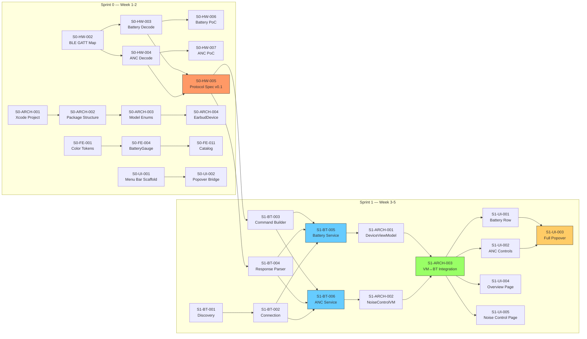

# 📋 Sprint Backlog — Phase 0 & Phase 1

## Xiaomi REDMI Buds 8 Pro — Native macOS Companion App

**Prepared by:** Lead Product Manager  
**Date:** 2026-11-05  
**Device:** REDMI Buds 8 Pro (FW 3.2.2.6)  
**Team:** 7 Agents  

---

## Agent Roles Reference

| Emoji | Role | Abbreviation |
|-------|------|-------------|
| 👔 | Lead Product Manager | Lead PM |
| 📋 | Product Manager | PM |
| 🎨 | Lead Frontend Engineer | Lead FE |
| 🖥️ | Frontend Engineer | FE |
| 🏗️ | Lead Software Engineer | Lead SE |
| 💻 | Software Engineer (macOS) | SE macOS |
| 🔧 | Hardware Engineer | HW Eng |

---

## Sprint 0 — Research & Design Foundation

**Duration:** Week 1-2 (10 working days)  
**Goal:** Understand the Bluetooth protocol, establish the design system, scaffold the project, and produce all planning documents.  
**Sprint Theme:** *"Know the hardware, design the foundation, scaffold the code."*

### 👔 Lead Product Manager Tasks

| ID | Title | Owner | Status | Est. | Acceptance Criteria |
|----|-------|-------|--------|------|-------------------|
| S0-PM-001 | Competitive analysis report | 👔 Lead PM | 🟡 In Progress | 2d | Documented analysis of AirPods (macOS integration), Sony Headphones Connect (mobile-only), Bose Music (mobile-only). Gap analysis of what Xiaomi macOS users are missing. Positioning statement defined. File: `docs/COMPETITIVE_ANALYSIS.md` |
| S0-PM-002 | Product vision & strategy document | 👔 Lead PM | 🟡 In Progress | 2d | Vision statement, target personas, MoSCoW prioritization, go-to-market plan (GitHub → ProductHunt → Reddit), success metrics (DAU/MAU/NPS targets), distribution strategy (DMG + Sparkle). File: `docs/PRODUCT_VISION.md` |
| S0-PM-003 | Sprint backlog for Phase 0-1 | 👔 Lead PM | 🟡 In Progress | 1d | All tasks for Sprint 0 and Sprint 1 documented with ID, title, owner, status, estimate, and acceptance criteria in table format. File: `docs/SPRINT_BACKLOG.md` |
| S0-PM-004 | Approve Phase 1 roadmap & priorities | 👔 Lead PM | ⬜ Not Started | 0.5d | Written sign-off on Phase 1 scope. P0 features confirmed: battery, ANC toggle, ANC depth, connection management, menu bar popover, main window. Documented in sprint backlog. |
| S0-PM-005 | Risk register review & mitigation plan | 👔 Lead PM | ⬜ Not Started | 0.5d | All 10 risks from PLANNING.md reviewed. Top 3 risks (protocol RE, CoreBluetooth limits, LDAC negotiation) have concrete mitigation actions assigned to owners with deadlines. |

### 📋 Product Manager Tasks

| ID | Title | Owner | Status | Est. | Acceptance Criteria |
|----|-------|-------|--------|------|-------------------|
| S0-PRD-001 | PRD: Battery Level Display | 📋 PM | ⬜ Not Started | 1d | User stories for battery display (L/R/Case). Acceptance criteria: shows individual percentages, color-coded bars (green >20%, yellow >10%, red ≤10%), updates in real-time. Edge cases: case closed, one earbud in case, BT disconnected. |
| S0-PRD-002 | PRD: ANC Mode Control | 📋 PM | ⬜ Not Started | 1d | User stories for ANC toggle (Transparency/NC/Off), Smart ANC toggle, ANC depth slider. Acceptance criteria: mode switch < 500ms, slider range Light→Deep, visual feedback on mode change. Edge cases: mode switch during call, BT reconnection. |
| S0-PRD-003 | PRD: Connection Management | 📋 PM | ⬜ Not Started | 1d | User stories for auto-connect, manual connect/disconnect, connection status display. Acceptance criteria: auto-connect on app launch < 3s, clear connected/disconnected state, graceful handling of out-of-range. |
| S0-PRD-004 | PRD: Menu Bar Popover | 📋 PM | ⬜ Not Started | 1d | User stories for menu bar interaction. Wireframe of popover layout (320×480pt). Content: battery row, ANC picker, depth slider, sound mode dropdown, "Open Settings" button. Interaction: click to open, click outside to close. |
| S0-PRD-005 | PRD: Main Window (NavigationSplitView) | 📋 PM | ⬜ Not Started | 1d | User stories for settings window. Wireframe of sidebar (6 items) + detail pane. Navigation flow: sidebar selection → detail page transition. Window specs: min 680×500, default 780×600. |
| S0-PRD-006 | UX competitive teardown | 📋 PM | ⬜ Not Started | 1d | Side-by-side comparison of Android Xiaomi Earbuds app screens vs. proposed macOS equivalents. Annotated screenshots (from `screenshots-sample-apps-android/`) showing which Android elements map to which macOS HIG components. |
| S0-PRD-007 | Define telemetry events for MVP | 📋 PM | ⬜ Not Started | 0.5d | List of anonymous telemetry events to track: `app_launched`, `device_connected`, `anc_mode_changed`, `anc_depth_adjusted`, `popover_opened`, `settings_opened`. Each event has name, properties, and trigger condition. |

### 🎨 Lead Frontend Engineer Tasks

| ID | Title | Owner | Status | Est. | Acceptance Criteria |
|----|-------|-------|--------|------|-------------------|
| S0-FE-001 | Design system: Color tokens | 🎨 Lead FE | ⬜ Not Started | 0.5d | `DesignSystem/Tokens/ColorTokens.swift` — Semantic colors for Light/Dark mode: `cardBackground`, `sidebarBackground`, `primaryAccent`, `batteryGreen/Yellow/Red`, `destructive`, `secondaryLabel`, `tertiaryLabel`. All colors use system color names (no hardcoded hex). Compiles with Swift 6. |
| S0-FE-002 | Design system: Typography tokens | 🎨 Lead FE | ⬜ Not Started | 0.5d | `DesignSystem/Tokens/TypographyTokens.swift` — Font scale definitions using SF Pro: `headline`, `body`, `callout`, `caption`, `title2`, `largeTitle`. Type aliases or view modifiers for consistent usage. |
| S0-FE-003 | Design system: Spacing tokens | 🎨 Lead FE | ⬜ Not Started | 0.5d | `DesignSystem/Tokens/SpacingTokens.swift` — Constants: `spacingXS=4`, `spacingSM=8`, `spacingMD=12`, `spacingLG=16`, `spacingXL=20`, `sidebarWidth=200`, `popoverWidth=320`, `popoverMaxHeight=480`. |
| S0-FE-004 | Component: BatteryGaugeView | 🎨 Lead FE | ⬜ Not Started | 0.5d | `DesignSystem/Components/BatteryGaugeView.swift` — Takes `level: Double` (0-1) and `label: String`. Shows `ProgressView(.linear)` with color coding (green >0.2, yellow >0.1, red ≤0.1). Shows percentage text. Has `accessibilityLabel`. SwiftUI Preview included. |
| S0-FE-005 | Component: ANCModePicker | 🎨 Lead FE | ⬜ Not Started | 0.5d | `DesignSystem/Components/ANCModePicker.swift` — `Picker(.segmented)` with 3 options: Transparency (SF Symbol `ear`), Noise Cancellation (SF Symbol `ear.trianglebadge.exclamationmark`), Off. Binding to `ANCMode` enum. VoiceOver labels. SwiftUI Preview. |
| S0-FE-006 | Component: DepthSlider | 🎨 Lead FE | ⬜ Not Started | 0.5d | `DesignSystem/Components/DepthSlider.swift` — `Slider(value:in:)` with `minimumValueLabel("Light")` and `maximumValueLabel("Deep")`. Binding to `Double` (0-1). Accessibility value description. SwiftUI Preview. |
| S0-FE-007 | Component: SettingToggleRow | 🎨 Lead FE | ⬜ Not Started | 0.5d | `DesignSystem/Components/SettingToggleRow.swift` — `Toggle` wrapping `VStack(alignment: .leading)` with title (`Text`, `.body`) and optional description (`Text`, `.caption`, `.secondary`). SwiftUI Preview. |
| S0-FE-008 | Component: ConnectionStatusDot | 🎨 Lead FE | ⬜ Not Started | 0.5d | `DesignSystem/Components/ConnectionStatusDot.swift` — Small circle: green with `.symbolEffect(.pulse)` when connected, gray when disconnected. `accessibilityLabel("Connected"/"Disconnected")`. SwiftUI Preview. |
| S0-FE-009 | Component: DeviceHeaderView | 🎨 Lead FE | ⬜ Not Started | 0.5d | `DesignSystem/Components/DeviceHeaderView.swift` — Centered device image (placeholder), device name (`Text`, `.title2`), Dolby Audio badge (`Text`, `.caption`, `.secondary`). SwiftUI Preview. |
| S0-FE-010 | Component: SectionCard | 🎨 Lead FE | ⬜ Not Started | 0.5d | `DesignSystem/Components/SectionCard.swift` — `GroupBox` wrapper with optional title. Consistent padding using spacing tokens. SwiftUI Preview. |
| S0-FE-011 | Component catalog (all previews) | 🎨 Lead FE | ⬜ Not Started | 1d | `DesignSystem/Previews/ComponentCatalog.swift` — Single file with `#Preview` blocks for all 7 components (S0-FE-004 through S0-FE-010). Each preview shows component in multiple states (empty, half, full; connected/disconnected; light/dark). |
| S0-FE-012 | Accessibility audit checklist | 🎨 Lead FE | ⬜ Not Started | 0.5d | Document listing VoiceOver labels, keyboard navigation requirements, and reduced motion considerations for every component. Checklist format with pass/fail criteria for MVP. |

### 🖥️ Frontend Engineer Tasks

| ID | Title | Owner | Status | Est. | Acceptance Criteria |
|----|-------|-------|--------|------|-------------------|
| S0-UI-001 | Menu bar app scaffold (NSStatusItem) | 🖥️ FE | ⬜ Not Started | 1d | `App/XiaomiEarbudsApp.swift` — App launches as menu bar app (no dock icon). `MenuBarExtra` with `headphones` SF Symbol. Click opens empty popover (SwiftUI view placeholder). App appears in menu bar on launch. |
| S0-UI-002 | NSPopover SwiftUI bridge | 🖥️ FE | ⬜ Not Started | 1d | `App/AppDelegate.swift` — `NSStatusItem` + `NSPopover` hosting SwiftUI content view. Popover size: 320×480pt. Transient behavior (closes on click outside). `.ultraThinMaterial` background. |
| S0-UI-003 | Main window scaffold | 🖥️ FE | ⬜ Not Started | 1d | `Views/MainWindow/MainWindowView.swift` — `NavigationSplitView` with sidebar (placeholder list items) and detail pane (placeholder text). Window opens from "Open Settings" button in popover. Min size 680×500. |
| S0-UI-004 | Sidebar navigation scaffold | 🖥️ FE | ⬜ Not Started | 0.5d | `Views/MainWindow/SidebarView.swift` — `List` with 6 items: Overview (🎧), Noise Control (🔇), Audio (🎵), Spatial Audio (🌐), Gestures (👆), Settings (⚙️). Uses SF Symbols. Selection state binding. |
| S0-UI-005 | Content router scaffold | 🖥️ FE | ⬜ Not Started | 0.5d | `Views/MainWindow/ContentRouter.swift` — `switch` on sidebar selection → renders correct detail page view (placeholder views for now). |

### 🏗️ Lead Software Engineer Tasks

| ID | Title | Owner | Status | Est. | Acceptance Criteria |
|----|-------|-------|--------|------|-------------------|
| S0-ARCH-001 | Xcode project creation | 🏗️ Lead SE | ⬜ Not Started | 0.5d | New Xcode project: target macOS 15+, Swift 6, SwiftUI lifecycle. Entitlements: `com.apple.security.device.bluetooth`. Project builds and runs (shows empty window). |
| S0-ARCH-002 | Swift Package structure | 🏗️ Lead SE | ⬜ Not Started | 0.5d | Folder structure matching PLANNING.md: `App/`, `DesignSystem/`, `Models/`, `ViewModels/`, `Views/`, `Services/`, `Utilities/`, `Tests/`, `Resources/`. All folders created with placeholder files. |
| S0-ARCH-003 | Model definitions (enums) | 🏗️ Lead SE | ⬜ Not Started | 1d | All model enums from PLANNING.md: `ANCMode`, `AudioCodec`, `SampleRate`, `SoundMode`, `AudioQuality`, `SceneRendering`, `GestureAction`. Each is `Codable`, `Hashable`, `CaseIterable`. Unit tests for encoding/decoding. |
| S0-ARCH-004 | EarbudDevice model | 🏗️ Lead SE | ⬜ Not Started | 0.5d | `Models/EarbudDevice.swift` — `@Observable class EarbudDevice` with properties: `name`, `isConnected`, `batteryLeft`, `batteryRight`, `batteryCase`, `ancMode`, `ancDepth`, `codec`, `sampleRate`, `soundMode`, `firmwareVersion`. |
| S0-ARCH-005 | Android APK decompile & analysis | 🏗️ Lead SE | ⬜ Not Started | 3d | Decompile Xiaomi Earbuds APK using `jadx`. Extract: BLE service UUIDs, GATT characteristic UUIDs, command byte formats for battery/ANC/codec. Document findings in `docs/PROTOCOL_NOTES.md`. |
| S0-ARCH-006 | CI/CD pipeline setup (GitHub Actions) | 🏗️ Lead SE | ⬜ Not Started | 1d | `.github/workflows/build.yml` — Triggers on push to `main` and PR. Steps: checkout, setup Xcode, build (`xcodebuild`), run unit tests. Status badge in README. |

### 💻 Software Engineer (macOS) Tasks

| ID | Title | Owner | Status | Est. | Acceptance Criteria |
|----|-------|-------|--------|------|-------------------|
| S0-BT-001 | IOBluetooth API exploration | 💻 SE macOS | ⬜ Not Started | 1d | Spike: Write a Swift script that uses `IOBluetoothDevice` to find the paired REDMI Buds 8 Pro (B8:53:84:6B:BD:88), open a connection, and list available services. Document API surface, gotchas, async patterns. |
| S0-BT-002 | CoreBluetooth BLE exploration | 💻 SE macOS | ⬜ Not Started | 1d | Spike: Write a Swift script that uses `CBCentralManager` to scan for and connect to the earbuds via BLE. Enumerate all GATT services and characteristics. Log UUIDs, properties (read/write/notify), and descriptors. |
| S0-BT-003 | BluetoothManager actor scaffold | 💻 SE macOS | ⬜ Not Started | 1d | `Services/Bluetooth/BluetoothManager.swift` — `actor BluetoothManager` with: `func discover() async throws -> [EarbudDevice]`, `func connect(to:) async throws`, `func disconnect()`. Uses `CBCentralManager`. Compiles but uses placeholder/mock implementations. |
| S0-BT-004 | Protocol constants file | 💻 SE macOS | ⬜ Not Started | 0.5d | `Services/Protocol/ProtocolConstants.swift` — Known constants: device BT address, standard BLE service UUIDs (Battery 0x180F, Device Info 0x180A), placeholder Xiaomi custom service UUID. Constants populated as HW Engineer discovers them. |
| S0-BT-005 | AppSettings persistence | 💻 SE macOS | ⬜ Not Started | 0.5d | `Services/Persistence/AppSettings.swift` — `@AppStorage` wrapper for: `lastConnectedDeviceAddress`, `autoConnect`, `preferredCodec`, `showInDock`. Defaults defined. |

### 🔧 Hardware Engineer Tasks

| ID | Title | Owner | Status | Est. | Acceptance Criteria |
|----|-------|-------|--------|------|-------------------|
| S0-HW-001 | BT PacketLogger setup | 🔧 HW Eng | ⬜ Not Started | 0.5d | macOS PacketLogger installed and configured. Able to capture HCI packets between Mac and REDMI Buds 8 Pro. First capture file saved to `docs/captures/`. Instructions documented for team. |
| S0-HW-002 | BLE GATT service enumeration | 🔧 HW Eng | ⬜ Not Started | 2d | Complete map of all BLE GATT services and characteristics on the REDMI Buds 8 Pro. For each: UUID, type (standard/custom), properties (R/W/N), observed values. Documented in `docs/BLE_GATT_MAP.md` as a table. |
| S0-HW-003 | Battery protocol decode | 🔧 HW Eng | ⬜ Not Started | 1d | Identify exact BLE characteristic(s) for reading L/R/Case battery levels individually. Document byte format, polling interval, notification support. Verify against standard Battery Service (0x180F) or Xiaomi custom. |
| S0-HW-004 | ANC protocol decode | 🔧 HW Eng | ⬜ Not Started | 2d | Capture BT packets when switching ANC modes (Transparency/NC/Off) and adjusting depth slider on Android. Decode command format: which characteristic, opcode, payload bytes. Document write command and expected response/ACK. |
| S0-HW-005 | Protocol specification document (v0.1) | 🔧 HW Eng | ⬜ Not Started | 2d | `docs/PROTOCOL_SPEC.md` — Documents all decoded commands and responses from S0-HW-002 through S0-HW-004. Table format: Command name, Direction (App→Device / Device→App), Characteristic UUID, Opcode, Payload format, Example hex. |
| S0-HW-006 | PoC: Battery read script | 🔧 HW Eng | ⬜ Not Started | 1d | Working Python or Swift script that connects to REDMI Buds 8 Pro and reads L/R/Case battery levels. Outputs values to console. Serves as proof that the protocol decode is correct. |
| S0-HW-007 | PoC: ANC mode switch script | 🔧 HW Eng | ⬜ Not Started | 1d | Working Python or Swift script that connects and switches ANC mode between Transparency/NC/Off. Verifiable by hearing the mode change on the earbuds. |

---

## Sprint 1 — MVP

**Duration:** Week 3-5 (15 working days)  
**Goal:** Ship a functional menu bar app that displays battery levels, toggles ANC modes, adjusts ANC depth, and opens a settings window with Overview and Noise Control pages.  
**Sprint Theme:** *"Battery + ANC: the two features that make users install the app."*

### MVP Success Criteria (Exit Criteria for Sprint 1)

- [ ] App appears in macOS menu bar with `headphones` SF Symbol
- [ ] Clicking menu bar icon opens popover showing L/R/Case battery with color-coded bars
- [ ] ANC mode can be toggled (Transparency / NC / Off) via segmented picker in popover
- [ ] ANC depth can be adjusted (Light ↔ Deep) via slider in popover
- [ ] "Open Settings" button opens main window with NavigationSplitView
- [ ] Main window sidebar has 6 items; Overview and Noise Control pages are functional
- [ ] App auto-reconnects when earbuds come back in range
- [ ] All interactive controls have VoiceOver accessibility labels
- [ ] App works correctly in both Dark and Light mode
- [ ] Unit tests pass with ≥ 60% code coverage on service and ViewModel layers
- [ ] App uses < 50 MB memory and < 1% CPU when idle

### 👔 Lead Product Manager Tasks

| ID | Title | Owner | Status | Est. | Acceptance Criteria |
|----|-------|-------|--------|------|-------------------|
| S1-PM-001 | Sprint 1 kickoff & scope confirmation | 👔 Lead PM | ⬜ Not Started | 0.5d | Sprint 1 scope confirmed with all agents. P0 feature list locked. Any descoped items documented with rationale. |
| S1-PM-002 | Mid-sprint review (end of Week 4) | 👔 Lead PM | ⬜ Not Started | 0.5d | Progress review with all agents. Blockers identified and resolved. Scope adjustment if needed (documented). |
| S1-PM-003 | MVP acceptance testing | 👔 Lead PM | ⬜ Not Started | 1d | All MVP success criteria tested and verified. Bug list created for critical issues. Go/no-go decision for Phase 2 documented. |
| S1-PM-004 | README.md draft for GitHub | 👔 Lead PM | ⬜ Not Started | 0.5d | Draft README with: project description, screenshot placeholder, feature list, installation instructions (DMG), build instructions, contributing guidelines link, license (MIT). |

### 📋 Product Manager Tasks

| ID | Title | Owner | Status | Est. | Acceptance Criteria |
|----|-------|-------|--------|------|-------------------|
| S1-PRD-001 | UAT test plan for MVP | 📋 PM | ⬜ Not Started | 1d | Test scenarios document covering: battery display accuracy (compare with Android), ANC mode switch (all 3 transitions), ANC depth slider (min/mid/max), connection flow (connect/disconnect/reconnect), popover open/close, window navigation. Each scenario has steps, expected result, pass/fail column. |
| S1-PRD-002 | UAT execution & bug filing | 📋 PM | ⬜ Not Started | 2d | Execute all UAT scenarios from S1-PRD-001. File GitHub Issues for failures with: steps to reproduce, expected vs actual, severity (P0-P3), screenshot if applicable. |
| S1-PRD-003 | User flow validation | 📋 PM | ⬜ Not Started | 0.5d | Walk through the 3 primary user flows end-to-end: (1) First launch → connect → see battery, (2) Toggle ANC from popover, (3) Open settings → navigate sidebar. Document any UX friction points. |

### 🎨 Lead Frontend Engineer Tasks

| ID | Title | Owner | Status | Est. | Acceptance Criteria |
|----|-------|-------|--------|------|-------------------|
| S1-FE-001 | NavigationSplitView architecture | 🎨 Lead FE | ⬜ Not Started | 2d | Finalize `NavigationSplitView` setup with proper sidebar selection binding, detail pane routing, and column width constraints. Smooth transition animation between pages. Sidebar collapses gracefully on narrow window. |
| S1-FE-002 | Accessibility audit (MVP components) | 🎨 Lead FE | ⬜ Not Started | 1d | Audit all MVP components (S0-FE-004 through S0-FE-010) with VoiceOver enabled. Verify: every control has a label, sliders report value, pickers announce selection, focus order is logical. File issues for any failures. |
| S1-FE-003 | Dark/Light mode verification | 🎨 Lead FE | ⬜ Not Started | 0.5d | Test all MVP views in both Dark and Light mode. Verify no hardcoded colors, proper contrast ratios, battery colors visible in both modes. Screenshot comparison document. |
| S1-FE-004 | Animation polish (popover + transitions) | 🎨 Lead FE | ⬜ Not Started | 1d | Smooth spring animation on popover content changes. Connection status dot pulse animation. ANC mode switch visual feedback (0.2s ease-in-out). Reduced motion fallbacks implemented. |

### 🖥️ Frontend Engineer Tasks

| ID | Title | Owner | Status | Est. | Acceptance Criteria |
|----|-------|-------|--------|------|-------------------|
| S1-UI-001 | Menu bar popover: Battery row | 🖥️ FE | ⬜ Not Started | 1d | `Views/MenuBar/QuickBatteryView.swift` — Three-column `HStack` showing Left/Right/Case battery with `BatteryGaugeView` components. Shows "—" when earbuds disconnected. Updates in real-time via ViewModel binding. |
| S1-UI-002 | Menu bar popover: ANC controls | 🖥️ FE | ⬜ Not Started | 1d | `Views/MenuBar/QuickANCView.swift` — `ANCModePicker` (segmented) + `DepthSlider`. Connected to `NoiseControlViewModel`. Depth slider only visible when ANC mode is Noise Cancellation. Disabled state when disconnected. |
| S1-UI-003 | Menu bar popover: Quick actions & header | 🖥️ FE | ⬜ Not Started | 1d | `Views/MenuBar/MenuBarPopoverView.swift` — Complete popover layout: device header (name + connection dot), battery row, ANC section, divider, "Sound Mode" dropdown (placeholder), "Open Settings…" button. 320×420pt. |
| S1-UI-004 | Overview page (dashboard) | 🖥️ FE | ⬜ Not Started | 2d | `Views/Pages/OverviewPage.swift` — Device hero image (placeholder), device name + Dolby badge, battery row (reuse `QuickBatteryView`), ANC section (reuse popover components), quick actions section (Sound Mode dropdown, Codec label). Scrollable `Form` layout. |
| S1-UI-005 | Noise Control page | 🖥️ FE | ⬜ Not Started | 2d | `Views/Pages/NoiseControlPage.swift` — `Form` with sections: ANC Mode (`ANCModePicker`), Smart ANC (`SettingToggleRow`), ANC Depth (`DepthSlider`), Immersive Commute (`SettingToggleRow` — disabled placeholder). All connected to `NoiseControlViewModel`. |
| S1-UI-006 | Placeholder pages (Audio, Spatial, Gestures, Settings) | 🖥️ FE | ⬜ Not Started | 0.5d | Placeholder views for 4 remaining sidebar pages. Each shows page title + "Coming in Phase 2" message. Navigable from sidebar. |
| S1-UI-007 | Connection states UI | 🖥️ FE | ⬜ Not Started | 1d | Handle 4 states: (1) Connected — normal UI, (2) Connecting — spinner + "Connecting…", (3) Disconnected — grayed controls + "Connect" button, (4) Bluetooth Off — message + link to System Settings. Each state has distinct visual treatment. |

### 🏗️ Lead Software Engineer Tasks

| ID | Title | Owner | Status | Est. | Acceptance Criteria |
|----|-------|-------|--------|------|-------------------|
| S1-ARCH-001 | DeviceViewModel | 🏗️ Lead SE | ⬜ Not Started | 1d | `ViewModels/DeviceViewModel.swift` — `@Observable class DeviceViewModel`. Properties: `device: EarbudDevice?`, `connectionState: ConnectionState` (enum: disconnected, connecting, connected, bluetoothOff). Methods: `connect()`, `disconnect()`. Publishes state changes for SwiftUI binding. |
| S1-ARCH-002 | NoiseControlViewModel | 🏗️ Lead SE | ⬜ Not Started | 1d | `ViewModels/NoiseControlViewModel.swift` — `@Observable class NoiseControlViewModel`. Properties: `ancMode: ANCMode`, `smartANC: Bool`, `ancDepth: Double`, `immersiveCommute: Bool`. Methods: `setANCMode(_:)`, `setDepth(_:)`, `toggleSmartANC()`. Calls BluetoothManager service methods. |
| S1-ARCH-003 | ViewModel ↔ BT service integration | 🏗️ Lead SE | ⬜ Not Started | 2d | Wire `DeviceViewModel` and `NoiseControlViewModel` to `BluetoothManager`. ViewModels call async service methods. Service responses update ViewModel state. Error handling: if BT command fails, ViewModel reverts to previous state and surfaces error. |
| S1-ARCH-004 | Integration test: ANC toggle end-to-end | 🏗️ Lead SE | ⬜ Not Started | 1d | Integration test: ViewModel.setANCMode(.noiseCancellation) → BluetoothManager.writeCommand() → mock device ACK → ViewModel.ancMode == .noiseCancellation. Test all 3 mode transitions. Test error path (write fails → revert). |
| S1-ARCH-005 | Unit tests for ViewModels | 🏗️ Lead SE | ⬜ Not Started | 1d | Unit tests for `DeviceViewModel` and `NoiseControlViewModel`: state transitions, error handling, property updates. Mock `BluetoothManager`. Coverage target: ≥ 80% for ViewModel files. |

### 💻 Software Engineer (macOS) Tasks

| ID | Title | Owner | Status | Est. | Acceptance Criteria |
|----|-------|-------|--------|------|-------------------|
| S1-BT-001 | BluetoothManager: Device discovery | 💻 SE macOS | ⬜ Not Started | 2d | `Services/Bluetooth/BluetoothManager.swift` — Implements `CBCentralManager` delegate. Scans for REDMI Buds 8 Pro by name or saved address. Returns discovered devices. Handles BT power state (off/on/unauthorized). |
| S1-BT-002 | BluetoothManager: Connection lifecycle | 💻 SE macOS | ⬜ Not Started | 1d | Connect to discovered device. Handle connection success/failure. Auto-reconnect on disconnect (with exponential backoff: 1s, 2s, 4s, max 30s). Disconnect on user request. Connection timeout: 10s. |
| S1-BT-003 | XiaomiProtocol: Command builder | 💻 SE macOS | ⬜ Not Started | 2d | `Services/Protocol/CommandBuilder.swift` — Builds byte arrays for known commands: `readBattery()`, `setANCMode(_:)`, `setANCDepth(_:)`. Uses protocol spec from HW Engineer (S0-HW-005). Each method returns `Data` ready to write. |
| S1-BT-004 | XiaomiProtocol: Response parser | 💻 SE macOS | ⬜ Not Started | 2d | `Services/Protocol/ResponseParser.swift` — Parses BLE notification/read data into model objects. Handles: battery response → `BatteryInfo(left:right:case:)`, ANC ACK → `ANCMode`, generic ACK/NACK. Error handling for malformed packets. |
| S1-BT-005 | Battery read service | 💻 SE macOS | ⬜ Not Started | 2d | End-to-end battery reading: subscribe to battery characteristic notifications (or poll every 30s). Parse L/R/Case levels. Update `EarbudDevice.batteryLeft/Right/Case`. Handle partial data (e.g., case battery unavailable when case is closed). |
| S1-BT-006 | ANC mode write service | 💻 SE macOS | ⬜ Not Started | 2d | End-to-end ANC control: write ANC mode command to device, wait for ACK, update device state. Write ANC depth value. Handle write failures (retry once, then surface error). Verify mode change took effect. |
| S1-BT-007 | Unit tests for protocol layer | 💻 SE macOS | ⬜ Not Started | 1d | Unit tests for `CommandBuilder` and `ResponseParser`. Test known command bytes match expected hex. Test response parsing for valid and malformed data. Mock BLE characteristic data. Coverage target: ≥ 80%. |

### 🔧 Hardware Engineer Tasks

| ID | Title | Owner | Status | Est. | Acceptance Criteria |
|----|-------|-------|--------|------|-------------------|
| S1-HW-001 | Protocol test fixtures: Battery | 🔧 HW Eng | ⬜ Not Started | 0.5d | JSON or Swift fixtures containing captured battery response bytes for: full charge (100/100/100), low battery (15/20/1), asymmetric (100/50/0), disconnected case. Used by SE macOS for unit testing `ResponseParser`. |
| S1-HW-002 | Protocol test fixtures: ANC | 🔧 HW Eng | ⬜ Not Started | 0.5d | Fixtures for ANC commands: set mode (Transparency/NC/Off) — request bytes + expected ACK bytes. Set depth (0%, 50%, 100%) — request bytes + expected ACK bytes. Error response bytes. |
| S1-HW-003 | Codec protocol decode | 🔧 HW Eng | ⬜ Not Started | 2d | Capture BT packets when switching codec (LDAC→AAC→SBC) on Android. Decode command format. Document in `docs/PROTOCOL_SPEC.md` (append to v0.1). This is prep work for Sprint 2 but starts now to unblock Phase 2. |
| S1-HW-004 | Sound mode protocol decode | 🔧 HW Eng | ⬜ Not Started | 2d | Capture BT packets when switching sound modes (Balanced/Bass/Voice/Treble/Custom) on Android. Decode command format. Document in `docs/PROTOCOL_SPEC.md`. Prep for Sprint 2. |
| S1-HW-005 | Protocol spec update (v0.2) | 🔧 HW Eng | ⬜ Not Started | 1d | Update `docs/PROTOCOL_SPEC.md` with: battery read (confirmed), ANC control (confirmed), codec switch (decoded), sound mode (decoded). Mark each command's verification status (PoC-verified / captured-only / speculative). |

---

## Summary Statistics

### Sprint 0

| Agent | Task Count | Total Est. Days |
|-------|-----------|----------------|
| 👔 Lead PM | 5 | 6.0 |
| 📋 PM | 7 | 6.5 |
| 🎨 Lead FE | 12 | 6.0 |
| 🖥️ FE | 5 | 4.0 |
| 🏗️ Lead SE | 6 | 6.0 |
| 💻 SE macOS | 5 | 4.0 |
| 🔧 HW Eng | 7 | 9.5 |
| **TOTAL** | **47** | **42.0** |

### Sprint 1

| Agent | Task Count | Total Est. Days |
|-------|-----------|----------------|
| 👔 Lead PM | 4 | 2.5 |
| 📋 PM | 3 | 3.5 |
| 🎨 Lead FE | 4 | 4.5 |
| 🖥️ FE | 7 | 8.5 |
| 🏗️ Lead SE | 5 | 6.0 |
| 💻 SE macOS | 7 | 12.0 |
| 🔧 HW Eng | 5 | 6.0 |
| **TOTAL** | **35** | **43.0** |

### Combined Sprint 0 + Sprint 1

| Metric | Value |
|--------|-------|
| **Total Tasks** | 82 |
| **Total Estimated Person-Days** | 85.0 |
| **Duration** | 5 weeks (Week 1-5) |
| **Team Size** | 7 agents |
| **Critical Path** | HW Eng protocol decode → SE macOS BT service → Lead SE ViewModel integration → FE UI binding |

---

## Dependencies & Critical Path

**Critical path highlighted:** Protocol Spec → Command Builder/Response Parser → Battery & ANC Services → ViewModel Integration → UI Binding

---

## Status Legend

| Symbol | Status | Meaning |
|--------|--------|---------|
| ⬜ | Not Started | Task has not begun |
| 🟡 | In Progress | Actively being worked on |
| 🔵 | In Review | Complete, awaiting review |
| ✅ | Done | Accepted, meets criteria |
| 🔴 | Blocked | Cannot proceed — see description |
| ⏸️ | Paused | Deprioritized or waiting for dependency |

---

## Sprint Ceremonies

| Ceremony | Frequency | Duration | Participants | Purpose |
|----------|-----------|----------|-------------|---------|
| Sprint Planning | Start of sprint | 1 hour | All 7 agents | Scope confirmation, task assignment, dependency review |
| Daily Standup | Daily | 15 min | All 7 agents | Blockers, progress, today's plan |
| Mid-Sprint Review | Mid-sprint | 30 min | All 7 agents | Progress check, scope adjustment if needed |
| Sprint Demo | End of sprint | 1 hour | All 7 agents | Working software demo, acceptance testing |
| Sprint Retrospective | End of sprint | 30 min | All 7 agents | What went well, what to improve, action items |

---

*Document version 1.0 — Lead Product Manager — 2026-11-05*
